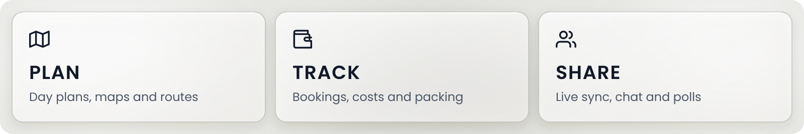
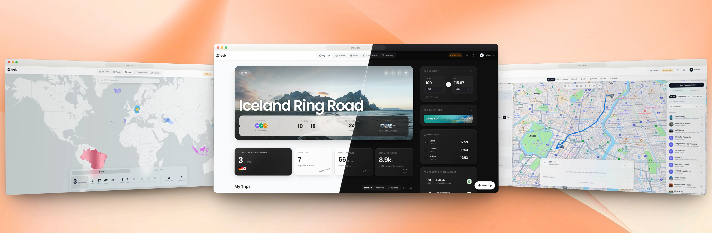
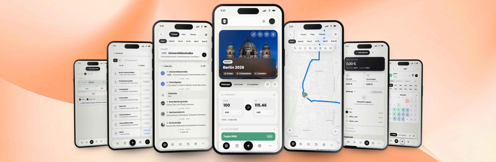

<div align="center">

<picture>
  <source media="(prefers-color-scheme: dark)" srcset="docs/logo-trek-light.svg" />
  <source media="(prefers-color-scheme: light)" srcset="docs/logo-trek-dark.svg" />
  
</picture>

### Every part of your trip. One app you own.

TREK has grown from a travel planner into a whole ecosystem for trips: plan together in real time on a live map, build hikes, tours and road trips, keep bookings and shared costs in order, pack, write the journal, lay out the photo book and hand the busy work to the built-in AI. Self-hosted, on the web, on your phone and offline.

<br />

<a href="https://demo.liketrek.com"></a>
&nbsp;
<a href="https://hub.docker.com/r/mauriceboe/trek"></a>
&nbsp;
<a href="https://sonarcloud.io/project/overview?id=liketrek_TREK"></a>
&nbsp;

&nbsp;
<a href="https://discord.gg/NhZBDSd4qW"></a>
&nbsp;
<a href="https://kanban.pakulat.org/shared/I4wxF6inOOMB0C6hH6kQm3efyNxFjwyI"></a>
&nbsp;
<a href="https://ko-fi.com/mauriceboe"></a>
&nbsp;
<a href="https://www.buymeacoffee.com/mauriceboe"></a>
&nbsp;
<a href="LICENSE"></a>
&nbsp;
<a href="https://github.com/liketrek/TREK/releases"></a>
&nbsp;
<a href="https://hub.docker.com/r/mauriceboe/trek"></a>
&nbsp;
<a href="https://github.com/liketrek/TREK"></a>

<sub>PUBLIC SERVICES PROUDLY SPONSORED BY</sub><br /><a href="https://cloud.dataforest.net/en?mtm_campaign=trek"><picture><source media="(prefers-color-scheme: dark)" srcset="docs/sponsors/dataforest-light.svg" /><source media="(prefers-color-scheme: light)" srcset="docs/sponsors/dataforest-dark.svg" /></picture></a>
</div>

---

<div align="center">


</div>

<br />

## What you get

<picture>
  <source media="(max-width: 700px)" srcset="docs/tiles/grid-mobile.svg" />
  <source media="(prefers-color-scheme: dark)" srcset="docs/tiles/grid-desktop-dark.svg" />
  
</picture>

<details>
<summary><b>See all features</b></summary>

<br />

Most of what follows is an addon an admin switches on or off. Lists, Costs, Documents, Collab, Tours, Vacay and Atlas ship on; Journey, Collections, MCP, the AI assistant, AI Parsing, Road trip, Dawarich and AirTrail ship off and are marked below.

<table>
<tr>
<td width="50%" valign="top">

#### 🧭 Planning

- **Day plans**: drag places, notes and bookings between days with undo, or drop a map marker straight onto a day
- **Maps**: Leaflet, Mapbox GL or MapLibre GL (OpenFreeMap, no token) with clustering, photo markers, route lines and a whole-trip route overview
- **Places**: search the TREK Places index and OpenStreetMap with no key, or Google Places and Amap with one. Descriptions, hours and photos from Wikipedia, Wikidata and Wikimedia Commons, plus a rating and a custom image per place
- **Explore**: nearby places by category for the map view, from the TREK Places index with Overpass as fallback
- **Routes**: auto-sort a day (nearest neighbour then 2-opt, locked stops and hotels stay put), a travel mode per leg over OSRM or Valhalla, then open the day in Google Maps or CoMaps and a place in seven navigation apps
- **Public transport**: door-to-door itineraries over Transitous, or Google where Transitous has no data
- **Import and export**: Google Maps and Naver Maps lists, Google Maps directions links, GPX, KML and KMZ in; GPX and an ICS feed per trip or across all trips out
- **Weather**: 16-day forecast from Open-Meteo, no key, and the archive for dates beyond it
- **Trip dates**: move a trip and its days re-date themselves, with the bookings along or re-anchored. Trips also copy and archive
- **Road trip** (off by default): drives with stops, day windows and arrival times that recompute, route alternatives, hazards and EV charging with range

</td>
<td width="50%" valign="top">

#### 🥾 Tours

- **Seven tour types**: hike, city walk, run, bike (touring, road, gravel, MTB), paddle (kayak, canoe, SUP), horse ride, and ski and winter (alpine, cross-country, touring, snowshoe, winter hike)
- **Routing**: legs routed over Valhalla with shaping points, hand-drawn legs, route variants, round hikes of a wished length and trip places as stops, all with undo
- **Hikes**: routed within a maximum SAC grade (T1 to T6), the trail grades along the way, and via ferratas on the map
- **Terrain**: elevation profile, ascent and descent, and a 3D terrain map with grade colouring and a flyover, no token needed. Topo, hiking, cycling and satellite bases with sea marks and ski pistes as overlays
- **Multi-day tours**: one route cut into stages and spread across the trip's days
- **Along the way**: viewpoints, huts, water, food and more within a corridor of the route, inserted as a stop with the detour it adds
- **Ski, paddle and city walks**: a piste router by difficulty and lift type; a water router with portages, locks and a wind forecast; city walks with stays, opening hours and transit between stops
- **Plan against reality**: link a recorded GPX to a planned day and compare distance, ascent and time. Import trails from a wanderer instance, save tours to a collection and take them into another trip

</td>
</tr>
<tr>
<td width="50%" valign="top">

#### 🧳 Bookings and money

- **Reservations**: 18 booking types with status, confirmation code, travellers and attached files
- **Flights and trains**: several legs with stopovers and endpoint timezones, against 4,045 bundled airports so local times resolve without a key
- **Accommodation**: a stay spans a range of nights with a check-in window
- **Booking import**: EML, PDF, PKPass, HTML, TXT and photos of confirmations, through [KItinerary](https://invent.kde.org/pim/kitinerary) or an AI model, with a review step before anything is saved. Prices become linked costs
- **AirTrail** (off by default): import flights from a self-hosted AirTrail instance and keep them in sync
- **Costs**: split in integer cents with equal or custom shares, several payers, settle-up suggestions, a per-person summary, a settlement log and CSV export. A receipt photo can fill in an expense
- **Currencies**: one per expense with the rate frozen at entry, from Frankfurter with no key
- **Packing lists and to-dos**: categories, templates, assignees and visibility tiers; bags with weights as an admin switch; to-dos with due dates, priorities and reminders
- **Files**: attach to a trip, place, day or booking, 50 MB each and 500 MB for video, with trash and restore
- **PDF export**: cover, place photos, day notes, bookings and costs, with an optional page break per day

</td>
<td width="50%" valign="top">

#### 👥 Collaboration

- **Real-time sync** (WebSocket): edits land live for everyone who has the trip open
- **Members**: add by email or username, hand over ownership, or add guests who have no login at all
- **Permissions**: an admin maps each of 17 trip actions to admin, trip owner, trip member or everybody
- **Invites**: one reusable link per trip with an optional expiry, and admin signup invites that drop a new account straight into a trip
- **Public share**: a read-only trip page without an account, with switches for map, bookings, packing, costs and chat
- **Collab**: group chat with replies, reactions and link previews, shared notes, links, polls and a What's Next list, each one its own switch
- **Notifications**: an inbox grouped by day with answers right from the notification, and a per-user matrix of events against in-app, email, webhook, ntfy, Web Push and plugin channels

</td>
</tr>
<tr>
<td width="50%" valign="top">

#### 📔 Journey and TREK Studio

- **Journey** (off by default): dated entries with story, mood, weather and tags, photos and video from uploads, [Immich](https://immich.app) or Synology Photos, map views, co-authors, drafts and a public share link
- **Linked journal**: a trip can show one journal as its own, with the members picked on the trip as viewers or editors
- **Recorded days** (with Dawarich): keep a day's recorded route and turn its stays into entries
- **TREK Studio**: turn a journal into a printable photo book. 34 print-licensed typefaces, 17 themes, 108 designed pages in twelve styles, 160 recolourable stickers, text effects, layers and a Travel tab with route maps, country stamps and trip figures
- **Auto layout**: lays the whole book on the designed pages in the style of its theme, every photo in a frame, or rebuilds one spread
- **Print and share**: PDF export as pages or spreads with crop marks, several people editing at once, and design files to move a spread into another book

</td>
<td width="50%" valign="top">

#### 🗺️ Atlas, Vacay and Collections

- **Atlas**: countries and regions visited on [geoBoundaries](https://www.geoboundaries.org/) outlines, a bucket list, travel stats, and a tour activities tab with planned against recorded totals
- **Vacay**: leave calendar with half days, public holidays from date.nager.at, school holidays for 16 European countries, company holidays, carry-over between years, and joint or read-only sharing
- **Collections** (off by default): a place library outside any trip with lists, labels, ratings, a status per place, cover images, GPX and file export, copy into a trip, and sharing by invite
- **Dawarich** (off by default): link a Dawarich instance for recorded tracks, suggested stays and countries for the Atlas

</td>
</tr>
<tr>
<td width="50%" valign="top">

#### 🤖 AI assistant and MCP

- **AI assistant** (off by default): a chat that plans with you in a trip, across all your trips, in a journal and in Studio, and works with tours, costs, bookings, packing, Vacay and the Atlas
- **Your own model**: an API key for Anthropic, OpenAI, Gemini or OpenRouter, a ChatGPT plan, or any OpenAI-compatible endpoint, set for the instance or per user
- **You stay in charge**: reads run at once, every change waits as a card to apply or discard and can be undone for 15 minutes. Nothing leaves before you agree to the provider, and a file's text only with your consent
- **Attachments**: drop a booking confirmation, a GPX file or a photo into the chat, and the assistant offers what to do with it
- **MCP server** (off by default): OAuth 2.1 with mandatory PKCE and dynamic client registration, 410 tools, 30 resources and 4 prompts, 35 scopes in 17 groups ticked on the consent screen, and every call in the audit log
- **Addon-aware**: twelve addon gates decide which tools a session sees, and flipping one re-registers live sessions

</td>
<td width="50%" valign="top">

#### 🧩 Plugins

- **Third-party plugins**: install from the TREK registry or sideload a zip, with their own pages under `/plugins/<id>`
- **Sandboxed**: one child process per plugin, 66 grantable permissions, an admin-edited outbound host allowlist, memory and call caps
- **Trust**: registry downloads are pinned by sha256 and checked against the author's minisign key, a sideloaded zip is marked unverified, and `TREK_PLUGINS_ENABLED=false` turns the whole system off
- **Extension points**: map layers, place details, day schedules, PDF sections, Atlas layers, journal rows, trip warnings, search and photo providers, route profiles, notification channels and MCP tools
- **SDK**: [`trek-plugin-sdk`](https://www.npmjs.com/package/trek-plugin-sdk) with a CLI to create, validate, run against real data, sign and publish

</td>
</tr>
<tr>
<td width="50%" valign="top">

#### 📱 Mobile and offline

- **Installable**: iOS and Android straight from the browser, no App Store, standalone with a themed status bar
- **Phone layouts**: their own screens for every part of the app, with a bottom bar and dashboard widgets the user orders
- **Offline reads**: the app shell is precached and trips, places, tours, files and nearby places live in a per-user IndexedDB store, so a trip opens with no network
- **Offline writes**: changes queue and replay with an `X-Idempotency-Key`, and a stale edit waits for a keep-mine or keep-theirs choice
- **Offline maps**: raster and vector tiles of a trip downloaded ahead, and a switch that takes the whole app offline on purpose

</td>
<td width="50%" valign="top">

#### ⚙️ Admin, accounts and security

- **Sign-in**: password, OIDC and passkeys each switch on and off on their own, `OIDC_ONLY` leaves SSO as the only way in, and an OIDC claim can grant admin
- **SSO and 2FA**: one OIDC provider by discovery with PKCE (Authentik, Keycloak, Google and the like), TOTP with backup codes that an admin can require, and passkeys that count as the second factor
- **Sessions**: every sign-in is a session you can see and end, one by one or all others at once
- **Hardening**: rate limits on sign-in, reset and 2FA, a password policy, secrets encrypted at rest and masked on read, and an SSRF guard on every URL you configure
- **Admin panel**: users and the permission matrix, defaults for new users, categories and templates, addons, plugins, storage, notifications, MCP tokens, backups, audit log and releases
- **Backups and storage**: scheduled backups with retention that restore their own secrets, and local or S3-compatible storage per content category with replicas
- **Appearance**: light, dark or follow the OS, seven colour schemes plus a custom accent, transparency, density, reduced motion and text size
- **28 languages**: en, de, es, fr, it, nl, hu, ru, zh, zh-TW, pl, cs, ar (right to left), he (right to left), br, id, tr, ja, ko, uk, gr, sv, vi, ca, az, et, sk, th
- **Help center**: a ? in the top bar with 381 step-by-step guides with screenshots, searched together with the wiki that ships in the image

</td>
</tr>
</table>

</details>

<br />

<div align="center">
  <a href="docs/screenshots/showcase-desktop-1.webp"></a>
  <a href="docs/screenshots/showcase-mobile.webp"></a>
</div>

<br />

## Powered by dataforest cloud

<div align="center">

<br />

<a href="https://cloud.dataforest.net/en?mtm_campaign=trek">
  <picture>
    <source media="(prefers-color-scheme: dark)" srcset="docs/sponsors/dataforest-light.svg" />
    <source media="(prefers-color-scheme: light)" srcset="docs/sponsors/dataforest-dark.svg" />
    
  </picture>
</a>

<br />
<br />

**Every TREK installation in the world searches through servers that dataforest cloud sponsors.**

The place index with over 88 million places, the address search in every TREK language and the planet-wide routing all run on dataforest cloud in Frankfurt, Germany, free of charge for everyone who self-hosts TREK. Without this sponsorship, these services would not exist in this form.

Thank you, dataforest, for backing open source this generously. 💚

<br />

<a href="https://cloud.dataforest.net/en?mtm_campaign=trek"></a>

Looking for a server for your own TREK? dataforest cloud is where TREK's own services live.

</div>

<br />

## AI usage

We use LLM-assisted coding tools across parts of this codebase. Nothing ships that a
maintainer has not read and understood: every change goes through a pull request, is
reviewed and tested, and has a human who can answer for it. "The AI wrote that" is not
an answer any of us would accept from ourselves.

See [**How we use AI in TREK**](https://github.com/liketrek/TREK/discussions/1851) for
the details.

<br />

## Get started in 30 seconds

```bash
ENCRYPTION_KEY=$(openssl rand -hex 32) docker run -d --name trek -p 3000:3000 \
  -e ENCRYPTION_KEY=$ENCRYPTION_KEY \
  -e COOKIE_SECURE=false \
  -v ./data:/app/data -v ./uploads:/app/uploads mauriceboe/trek
```

Open `http://localhost:3000`, or `http://<server-ip>:3000` from another machine. On first boot TREK seeds an admin account — if you set `ADMIN_EMAIL`/`ADMIN_PASSWORD` those are used, otherwise the credentials are printed to the container log (`docker logs trek`).

`COOKIE_SECURE=false` is only for trying TREK over plain HTTP: without it the browser drops the session cookie and the login does not stick. Once TREK sits behind HTTPS (see [Reverse Proxy](#reverse-proxy)), remove it.

> [!TIP]
> **No server yet?** TREK's own public services run on [**dataforest cloud**](https://cloud.dataforest.net/en?mtm_campaign=trek), our infrastructure sponsor. A small seed is plenty for a TREK instance and is ready within a minute.

<div align="center">

<a href="#docker-compose-production">Docker Compose</a>&nbsp;&nbsp;·&nbsp;&nbsp;<a href="#helm-kubernetes">Helm / Kubernetes</a>&nbsp;&nbsp;·&nbsp;&nbsp;<a href="#install-as-app-pwa">Install as PWA</a>&nbsp;&nbsp;·&nbsp;&nbsp;<a href="#reverse-proxy">Reverse Proxy</a>

</div>

<br />

## Tech stack

<div align="center">


</div>

Real-time sync via WebSocket (`ws`). Backend on NestJS 11. State with Zustand. Auth via JWT + OAuth 2.1 + OIDC + Passkeys (WebAuthn) + TOTP MFA. Weather via Open-Meteo (no key required). Maps with Leaflet and Mapbox GL.

<br />

<h2 id="docker-compose-production">Docker Compose (production)</h2>

The repository ships a ready-to-use [`docker-compose.yml`](docker-compose.yml)
with secure defaults and every option documented inline. Download it, then:

```bash
docker compose up -d
```

See [Install with Docker Compose](https://github.com/liketrek/TREK/wiki/Install-Docker-Compose)
for the full walkthrough.

<br />

<h2 id="helm-kubernetes">Helm (Kubernetes)</h2>

```bash
helm repo add trek https://chart.liketrek.com
helm repo update
helm install trek trek/trek
```

See [`charts/README.md`](https://github.com/liketrek/TREK/blob/main/charts/README.md) for values.

<br />

<h2 id="install-as-app-pwa">Install as App (PWA)</h2>

TREK works as a Progressive Web App — no App Store needed.

1. Open TREK in the browser (HTTPS required)
2. **iOS**: Share ▸ *Add to Home Screen*
3. **Android**: Menu ▸ *Install app* (or *Add to Home Screen*)

TREK then launches fullscreen with its own icon, just like a native app.

<br />

## Updating

See [Updating](https://github.com/liketrek/TREK/wiki/Updating) — Docker Compose,
Docker run, Helm, Portainer, Unraid and Proxmox, plus the encryption-key note.

<br />

<h2 id="reverse-proxy">Reverse Proxy</h2>

For production, put TREK behind a TLS-terminating reverse proxy. TREK uses WebSockets for real-time sync, so the proxy **must** support WebSocket upgrades on `/ws`.

If you use the MCP addon, the proxy must also pass the `Mcp-Session-Id` header through in both directions on `/mcp` — Nginx and Caddy do this by default, but a proxy that strips it makes every tool call open a new session instead of reusing one. See the [Reverse Proxy wiki page](https://github.com/liketrek/TREK/wiki/Reverse-Proxy) for details.

<details>
<summary>Nginx</summary>

```nginx
server {
    listen 80;
    server_name trek.yourdomain.com;
    return 301 https://$host$request_uri;
}

server {
    listen 443 ssl http2;
    server_name trek.yourdomain.com;

    ssl_certificate     /etc/ssl/fullchain.pem;
    ssl_certificate_key /etc/ssl/privkey.pem;

    # 500 MB covers backup-restore uploads (capped at 500 MB server-side).
    client_max_body_size 500m;

    location / {
        proxy_pass http://localhost:3000;
        proxy_http_version 1.1;
        proxy_set_header Host $host;
        proxy_set_header X-Real-IP $remote_addr;
        proxy_set_header X-Forwarded-For $proxy_add_x_forwarded_for;
        proxy_set_header X-Forwarded-Proto $scheme;
    }

    location /ws {
        proxy_pass http://localhost:3000;
        proxy_http_version 1.1;
        proxy_set_header Upgrade $http_upgrade;
        proxy_set_header Connection "upgrade";
        proxy_set_header Host $host;
        proxy_read_timeout 86400;
    }

    # Only needed if you use the MCP addon. Responses are Server-Sent Events,
    # so buffering must be off or tool results arrive late.
    location /mcp {
        proxy_pass http://localhost:3000;
        proxy_http_version 1.1;
        proxy_set_header Host $host;
        proxy_set_header X-Real-IP $remote_addr;
        proxy_set_header X-Forwarded-For $proxy_add_x_forwarded_for;
        proxy_set_header X-Forwarded-Proto $scheme;
        proxy_buffering off;
        proxy_read_timeout 3600s;
    }
}
```

</details>

<details>
<summary>Caddy</summary>

```caddy
trek.yourdomain.com {
    reverse_proxy localhost:3000
}
```

Caddy handles TLS and WebSockets automatically.

</details>

<br />

## Environment variables

Every variable, its default and what it does: see
[Environment Variables](https://github.com/liketrek/TREK/wiki/Environment-Variables).

## Data sources

The Atlas map's country and sub-national (province/county) boundaries come from
[**geoBoundaries**](https://www.geoboundaries.org/) (Runfola et al., 2020), licensed
[CC BY 4.0](https://creativecommons.org/licenses/by/4.0/). See [NOTICE.md](NOTICE.md)
for full third-party attributions.

<br />

## License

TREK is [AGPL v3](LICENSE). Self-host freely for personal or internal company use. If you modify and offer TREK as a network service to third parties, your modifications must be open-sourced under the same licence.
