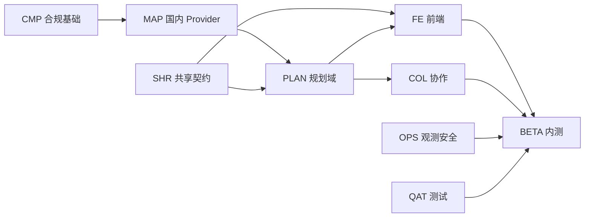

# TREK 中国版 MVP 开发任务清单

- **依据**：`docs/TREK中国版改造技术评估报告.md`、`docs/china-ai-travel-mvp-design.md`
- **目标**：交付"一句话生成 → 可编辑草案 → 用户确认 → 写入 TREK 行程 → 邀请同行者"的最小闭环
- **范围边界**：Web/PWA；国内 5 个首批城市；不含站内支付、机票酒店交易、微信小程序、原生 App、独立 Java AI 服务
- **状态标记**：`[ ]` 待启动 · `[~]` 进行中 · `[x]` 已完成 · `[!]` 阻塞
- **任务编号**：`CMP` 合规基础、`MAP` 国内数据、`PLAN` 规划域、`SHR` 共享契约、`FE` 前端、`OPS` 观测安全、`BETA` 内测、`POST` 超出 MVP

---

## 1. 里程碑与门禁

| 里程碑 | 内容 | 通过条件（Gate） |
|---|---|---|
| M0 立项冻结 | 范围、合规结论、评估集、品牌 | 许可/商标/数据供应商书面结论；30 组标准需求定稿 |
| M1 国内基础 | Provider 白名单、高德默认、天气抽象、跨境关闭 | 5 城市地点/路线回归通过；无未登记跨境请求 |
| M2 规划域骨架 | 实体、迁移、API、需求解析、POI 检索 | 30 组需求全部解析或正确追问；零编造 POI |
| M3 草案闭环 | 排程、校验、版本、应用写入 | 应用前零写入；重复应用幂等；错误可撤销 |
| M4 协作与体验 | 草案页、地图、来源、警告、分享与成员 | 双人同时查看/修改；离线恢复无重复 |
| M5 内测发布 | 观测、限流、脱敏、运营开关 | 可定位一次生成的全部调用；可一键关闭模型/地图 |

> 发布阻断：任一未确认写入、越权读取、无来源关键事实、坐标漂移、未登记跨境链路、未完成 AGPL/商标处理。

---

## 2. 合规与基础（CMP）

- [ ] **CMP-01 许可证与商标结论**
  - 产出：`docs/legal/agpl-trademark-review.md`（结论、部署方式、源码提供方式）
  - 验收：明确"对外 SaaS 是否提供修改版源码"与品牌替换清单
- [ ] **CMP-02 数据出境清单**
  - 产出：`docs/legal/data-flow.md`（模型、地图、天气、图片、邮件、监控、对象存储）
  - 验收：每条链路有开关、日志与责任人；含个人信息链路单独标注
- [ ] **CMP-03 品牌替换**
  - 改动：站点名称、Logo、`client` 静态资源、`README`、`docs`
  - 验收：界面与元数据无 TREK 商标；保留上游 LICENSE/NOTICE
- [ ] **CMP-04 合规开关矩阵**
  - 改动：`server/.env.example`、`charts/trek/values.yaml`、管理端设置页
  - 验收：`TREK_PLACES_ENABLED=false` 可强制；模型/天气/图片 Provider 均可关闭
- [ ] **CMP-05 隐私与账号流程**
  - 改动：隐私政策页、注册/注销/导出/删除入口
  - 验收：账号注销可清理草案、日志与上传文件

---

## 3. 国内数据 Provider（MAP）

- [ ] **MAP-01 境内强制高德策略**
  - 改动：`server/src/nest/maps/places-provider.selector.ts`
  - 内容：按 `country_code=CN` 或城市白名单强制 `amap`；记录 provider 与查询时间
  - 验收：境内外分别命中预期 Provider；不可用时明确报错，不静默回退境外
- [ ] **MAP-02 高德配额与缓存**
  - 改动：`server/src/nest/maps/providers/amap.provider.ts`、`server/src/nest/maps/place-details.resolver.ts`
  - 内容：超时、限流、重试、POI 详情缓存与降级提示
  - 验收：429/超时下返回可重试状态；缓存命中不重复计费
- [ ] **MAP-03 路线估算统一封装**
  - 改动：`server/src/nest/routing-relay/routing-relay.service.ts`、`amap-directions.client.ts`
  - 内容：驾车/步行/骑行模式统一返回 `{mode, minutes, distanceMeters}`
  - 验收：5 城市抽样路线耗时误差在可接受区间；失败可降级为"待确认"
- [ ] **MAP-04 天气 Provider 抽象**
  - 改动：`server/src/nest/weather/weather.service.ts`、`weather.impl.ts`
  - 内容：`WeatherProvider` 接口；Open-Meteo 作为默认实现之一；国内 Provider 可插拔
  - 验收：切换 Provider 不改调用方；不可用时行程生成不依赖天气
- [ ] **MAP-05 GCJ-02 回归**
  - 改动：无代码；新增测试 `shared/src/geo/gcj02.spec.ts`（如已存在则补用例）
  - 验收：高德出入坐标无肉眼可见偏移
- [ ] **MAP-06 图片授权与来源展示**
  - 改动：`server/src/nest/place-photos/`、`server/src/nest/amap-photo/`
  - 内容：图片来源、授权范围、缓存策略；前台展示来源
  - 验收：每张图可追溯来源；不可授权图片不落库

---

## 4. 规划域后端（PLAN）

### 4.1 数据模型与迁移

- [ ] **PLAN-01 实体与迁移**
  - 新增：`server/src/db/entities/AiTravelPlans.entity.ts`
  - 新增：`server/src/db/entities/AiTravelPlanRevisions.entity.ts`
  - 新增：`server/src/db/migrations/Migration2026xxxx_ai_travel_plans.ts`
  - 字段：`status`、`request_json`、`current_revision`、`target_trip_id`、`applied_trip_id`、`expires_at`、`draft_json`、`facts_json`、`warnings_json`、`model_meta_json`
  - 验收：迁移可向上/向下执行；实体生成检查通过
- [ ] **PLAN-02 仓储与事务**
  - 新增：`server/src/db/repositories/AiTravelPlan.repository.ts`
  - 约束：只经 repository + `UnitOfWork` 访问；不使用领域外裸 SQL
  - 验收：并发创建/修订无脏写

### 4.2 模块与 API

- [ ] **PLAN-03 模块骨架**
  - 新增：`server/src/nest/ai-travel-plan/ai-travel-plan.module.ts`
  - 新增：`server/src/nest/ai-travel-plan/ai-travel-plan.controller.ts`
  - 新增：`server/src/nest/ai-travel-plan/ai-travel-plan.service.ts`
  - 新增：`server/src/nest/ai-travel-plan/ai-travel-plan.dto.ts`
  - 改动：`server/src/nest/app.module.ts`
  - 验收：模块可启动；OpenAPI 可见 5 个端点
- [ ] **PLAN-04 API 契约**
  - `POST /api/ai-travel-plans`（创建 + 流式生成）
  - `GET /api/ai-travel-plans/:id`
  - `POST /api/ai-travel-plans/:id/revisions`
  - `POST /api/ai-travel-plans/:id/apply`
  - `POST /api/ai-travel-plans/:id/discard`
  - 验收：仅所有者可访问；应用请求必须带 `X-Idempotency-Key`
- [ ] **PLAN-05 权限与审计**
  - 内容：复用 `permissions/`、`audit/`；记录创建、修订、应用、丢弃
  - 验收：越权返回 403；审计可按 planId 还原全过程

### 4.3 生成流水线

- [ ] **PLAN-06 需求解析**
  - 新增：`server/src/nest/ai-travel-plan/planner-prompt.ts`
  - 内容：自然语言 → `TravelPlanRequest`；缺字段先追问；Zod 校验
  - 验收：30 组评估集全部解析或正确追问；禁止模型输出直接入库
- [ ] **PLAN-07 POI 检索与筛选**
  - 新增：`server/src/nest/ai-travel-plan/planner-provider.ts`
  - 内容：只调用白名单 Maps/Route/Weather；按兴趣、距离、人群过滤；保留来源
  - 验收：每个地点有 `provider`、`providerId`、坐标、`checkedAt`；零编造地点
- [ ] **PLAN-08 排程器**
  - 新增：`server/src/nest/ai-travel-plan/planner.service.ts`
  - 内容：开放时段、游玩时长、午餐窗口、每日上限、交通耗时排布
  - 验收：无时间冲突；单日超限产生 blocking
- [ ] **PLAN-09 预算估算**
  - 内容：交通、活动、用户录入费用；缺价格标"待确认"，不编造总预算
  - 验收：预算区间可解释；不把未确认票价当事实
- [ ] **PLAN-10 确定性校验器**
  - 新增：`server/src/nest/ai-travel-plan/planner-validator.ts`
  - 规则：相邻 >90 分钟 warning；单日超时 blocking；预算超限；地点重复；缺坐标 blocking
  - 验收：规则单测覆盖正反例；warning 与 blocking 可区分
- [ ] **PLAN-11 流式生成与版本**
  - 内容：SSE 输出；每次修订生成新 revision；旧版本保留
  - 验收：断线可恢复；修订不覆盖历史

### 4.4 应用写入

- [ ] **PLAN-12 应用服务**
  - 新增：`server/src/nest/ai-travel-plan/planner-apply.service.ts`
  - 复用：`server/src/nest/trips/trip-writes.service.ts`、`trips.service.ts`、`days/`、`assignments/`、`budget/`
  - 模式：`new_trip` / `existing_trip`；事务 + 幂等 + 权限校验
  - 验收：应用前零行程写入；重复调用不产生第二份数据；应用后广播实时事件
- [ ] **PLAN-13 撤销路径**
  - 内容：应用结果保留创建/变更 ID；提供既有领域能力的撤销或手动恢复说明
  - 验收：一次应用可回滚或明确列出需手动删除的实体

---

## 5. 共享契约（SHR）

- [ ] **SHR-01 Request Schema**
  - 新增：`shared/src/ai-travel-plan/request.schema.ts`
  - 字段：目的地、出发地、日期/天数、人数结构、预算、节奏、兴趣、交通偏好、限制
- [ ] **SHR-02 Draft Schema**
  - 新增：`shared/src/ai-travel-plan/draft.schema.ts`
  - 字段：摘要、`factsCheckedAt`、逐日 items、`travelFromPrevious`、费用区间、来源、warnings
- [ ] **SHR-03 警告与来源模型**
  - 新增：`shared/src/ai-travel-plan/warnings.ts`
  - 约束：`severity=info|warning|blocking`；来源含 `provider/sourceId/checkedAt/freshness`
- [ ] **SHR-04 服务端 DTO 与前端类型共用**
  - 改动：`server` DTO 从 shared schema 推导；`client/src/api/aiTravelPlan.ts` 复用类型
  - 验收：类型检查通过；无重复定义

---

## 6. 前端（FE）

- [ ] **FE-01 路由与入口**
  - 改动：`client/src/App.tsx`（新增 `/plan`）
  - 改动：`client/src/pages/dashboard/`（新建入口"让 AI 帮我规划"，保留传统新建）
- [ ] **FE-02 需求表单**
  - 新增：`client/src/components/AiTravelPlan/TravelBriefForm.tsx`
  - 内容：自然语言 + 可选结构化字段；校验与追问展示
- [ ] **FE-03 草案时间线**
  - 新增：`client/src/components/AiTravelPlan/TravelDraftTimeline.tsx`
  - 内容：逐日时间轴、地点、交通方式与耗时、预计费用
- [ ] **FE-04 来源与警告**
  - 新增：`client/src/components/AiTravelPlan/TravelDraftSources.tsx`
  - 新增：`client/src/components/AiTravelPlan/TravelDraftWarnings.tsx`
  - 验收：每条关键事实可见来源与查询时间；blocking 不可直接应用
- [ ] **FE-05 应用确认卡**
  - 新增：`client/src/components/AiTravelPlan/TravelDraftApplyCard.tsx`
  - 内容：新增/变更的天、地点、备注、预算；新建与已有行程使用不同文案
- [ ] **FE-06 页面与状态**
  - 新增：`client/src/pages/aiTravelPlan/AiTravelPlanPage.tsx`
  - 新增：`client/src/pages/aiTravelPlan/useAiTravelPlan.ts`
  - 新增：`client/src/store/aiTravelPlanStore.ts`
  - 新增：`client/src/api/aiTravelPlan.ts`
  - 验收：创建、修订、丢弃、应用全流程可用；草案不进离线队列
- [ ] **FE-07 地图联动**
  - 内容：复用 `tripPlanner` 地图组件展示草案点位与路线；不新增地图引擎
  - 验收：点位与时间线一致；坐标无偏移
- [ ] **FE-08 中文文案**
  - 改动：i18n 资源文件（沿用 `client/src/i18n/` 机制）
  - 验收：无英文残留；错误提示可读
- [ ] **FE-09 响应式**
  - 验收：移动浏览器可用；关键操作可达

---

## 7. 协作、离线与实时（COL）

- [ ] **COL-01 应用后写入实时广播**
  - 改动：复用 `server/src/nest/realtime/`；应用事务提交后广播
  - 验收：另一成员无需刷新即可看到新增行程
- [ ] **COL-02 分享与成员**
  - 改动：复用 `share/`、`trip-members/`、`trip-invite/`
  - 验收：生成后可直接邀请同行者
- [ ] **COL-03 离线恢复**
  - 改动：`client/src/sync/mutationQueue.ts`、`tripSyncManager.ts`
  - 验收：断网修改后恢复不产生重复地点/日程
- [ ] **COL-04 幂等与重复提交**
  - 验收：双击应用、重试、刷新均只产生一次结果

---

## 8. 观测、安全与运营（OPS）

- [ ] **OPS-01 限流与费用上限**
  - 改动：`ai-connections/ai-usage.service.ts`、`app-settings.registry.ts`
  - 内容：按用户/实例限制生成次数与 Token 成本
- [ ] **OPS-02 脱敏与日志**
  - 内容：模型请求体、位置、同行人信息脱敏；链路日志含 planId/revision/provider
- [ ] **OPS-03 错误分类与降级**
  - 内容：模型超时、地图限流、天气不可用、Schema 失败分别可重试/可降级
- [ ] **OPS-04 运营开关**
  - 内容：城市白名单、模型开关、功能灰度、紧急停用
  - 验收：可按用户或全局关闭生成服务
- [ ] **OPS-05 SSRF 与 Provider 白名单**
  - 验收：模型不能触发任意 URL；仅允许登记 Provider

---

## 9. 测试与质量门禁（QAT）

- [ ] **QAT-01 单元测试**
  - shared：schema 合法/非法边界；server：解析、排程、校验、权限、事务；client：表单、草案、警告、确认
- [ ] **QAT-02 集成测试**
  - 创建 → 修订 → 应用 → 重复应用；Provider 失败路径
- [ ] **QAT-03 E2E**
  - 一句需求 → 草案 → 修改 → 应用 → 邀请成员 → 离线恢复
- [ ] **QAT-04 评估集**
  - 30 组标准需求（亲子、老人、雨天、低预算、自驾）
  - 指标：解析成功率、POI 有效率、应用成功率、三次内改完比例
- [ ] **QAT-05 质量脚本**
  - 运行：`npm run typecheck`、`npm run lint`、相关 `lint:*` 门禁、`npm test`
  - 验收：CI 全绿

---

## 10. 内测与验证（BETA）

- [ ] **BETA-01 内测招募**
  - 30–50 名目标用户，覆盖情侣/朋友、亲子、首次自由行
- [ ] **BETA-02 指标体系**
  - 行程生成成功率、三次内保存率、邀请同行者比例、付费意愿访谈
- [ ] **BETA-03 反馈闭环**
  - 每周评审失败原因 Top3，只修闭环问题
- [ ] **BETA-04 成功标准**
  - ≥30 名用户完成一次生成；≥70% 三次内保存；≥60% 邀请至少一名同行者；0 起未确认写入

---

## 11. 超出 MVP（POST，需单独评审）

- [ ] **POST-01 会员与支付**：`server/src/nest/billing/`（订阅、订单、回调验签、权益）
- [ ] **POST-02 AI 增值计费**：按次/积分、成本核算
- [ ] **POST-03 交易佣金**：联盟渠道、归因、对账
- [ ] **POST-04 商家供给**：商户/商品、审核、风控
- [ ] **POST-05 国内身份**：手机号/微信登录
- [ ] **POST-06 独立 AI 编排服务**：Java/Spring AI Alibaba（仅规模验证后）
- [ ] **POST-07 多端**：小程序、原生 App 发布

---

## 12. 依赖关系

关键路径：`CMP-04 → MAP-01/03/04 → PLAN-01/03/06/07/08/10/12 → SHR-01/02 → FE-02/03/05/06 → COL-01/03 → BETA`。

---

## 13. Definition of Done

一个任务完成需同时满足：

1. 代码合入且通过 `typecheck`、`lint`、相关单测；
2. 新增/修改文件与设计文档一致，无旁路 SQL、无跨层直连；
3. 有可复现的验收证据（测试、截图或日志）；
4. 涉及外部 Provider 的任务，记录配额、错误与降级行为；
5. 涉及用户数据的任务，更新数据流清单与隐私说明；
6. 不引入未登记的跨境网络请求。

---

## 14. 任务统计

| 分组 | 数量 |
|---|---|
| CMP 合规基础 | 5 |
| MAP 国内数据 | 6 |
| PLAN 规划域 | 13 |
| SHR 共享契约 | 4 |
| FE 前端 | 9 |
| COL 协作离线 | 4 |
| OPS 观测安全 | 5 |
| QAT 测试门禁 | 5 |
| BETA 内测 | 4 |
| POST 超出 MVP | 7 |
| **合计** | **62** |
