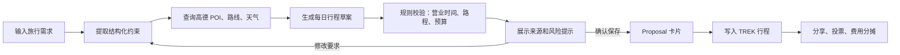
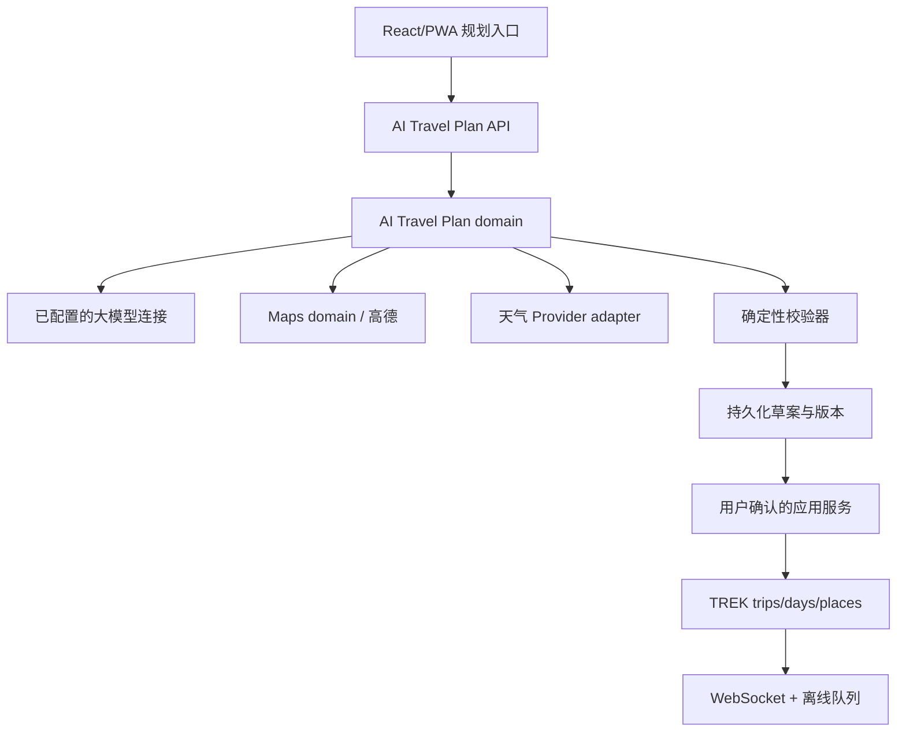

# 中国版 AI 旅行管家：MVP 方案与开发详设

## 1. 决策与边界

### 产品决策

首发产品是面向中国大陆用户的 Web/PWA：用户用一句自然语言描述短途旅行需求，系统产出一份可验证、可编辑、可共享的行程草案。用户确认后，草案才写入 TREK 的既有行程、地点、日程和预算模块。

首批场景限定为：情侣、朋友或亲子家庭的 2 至 5 天国内城市旅行。首批城市建议杭州、上海、北京、成都、广州；这是运营和测试范围，不是代码中的硬限制。

### 第一版不做

- 不做酒店、机票、门票的站内交易或支付闭环；仅提供合规的外部跳转或人工合作入口。
- 不开发 Android、iOS 和微信小程序；先发布 Web/PWA。
- 不在第一阶段引入独立 Java/Spring AI 服务。首版在同一 NestJS 应用中建立独立的旅行规划领域；现有 Assistant 仅选择性复用其模型连接、流式输出和建议卡片实现。
- 不自建公开地图服务、POI 数据库或路线引擎。
- 不让模型直接写数据库；所有修改必须是用户可查看、可选择和可撤销的 proposal。

### 成功标准

在内测期，至少 30 名真实用户完成一次行程生成；其中：

- 在完成基准压测后，为 P95 首版生成时延设定并达成可观测目标；
- 70% 的草案可在不超过三次编辑后被保存；
- 60% 的已保存行程至少邀请一名同行者；
- 0 起未经确认的行程、预算或预订数据写入；
- 每次推荐均显示数据来源、查询时间与无法确认的信息。

## 2. 用户流程



### 输入字段

自然语言为主，同时提供可选表单字段来降低歧义：出发地、目的地、日期或天数、人数及成员类型、总预算、交通偏好、节奏、兴趣、住宿偏好、禁忌与无障碍需求。

默认不收集精确实时位置；地图定位必须由用户单独授权。上传订单、同行人姓名、照片和位置轨迹均属于高敏感场景，必须有独立提示和用途说明。

### 输出内容

每份草案包含：行程摘要、每日时间轴、地点与顺序、两地点间交通方式和耗时、预计费用区间、住宿区域建议、事实来源、查询时间、风险/待确认事项。不能确认营业时间、价格或交通班次时必须明确标为“待确认”，不得由模型补全为事实。

## 3. 技术方案

### 复用现有能力

| 能力 | 现有模块 | MVP 做法 |
|---|---|---|
| AI 对话与流式回复 | `server/src/nest/assistant/` | 可选择性复用模型连接、SSE、审计和卡片的实现模式；不可假定现有助手可直接承担从零规划 |
| 模型连接、限额和密钥 | `server/src/nest/ai-connections/` | 复用实例/个人模型连接、审计与用量限制 |
| 目的地与 POI | `server/src/nest/maps/` | 强制中国境内优先使用高德 provider |
| 坐标转换 | `shared/src/geo/gcj02.ts` | 保持数据库 WGS-84，出入高德时转换 GCJ-02 |
| 国内路线 | `server/src/nest/routing-relay/amap-directions.client.ts` | 用于驾车、步行和骑行时间估算 |
| 行程写入 | `server/src/nest/trips/`、days、places、assignments | 用户确认后走既有 service/repository，不新增旁路 SQL |
| 离线与实时协作 | `client/src/sync/`、WebSocket | 已确认行程的写入沿用 mutation queue 和事件同步；生成中的规划草案不进入离线写队列 |

### 新增模块

新增 `shared/src/ai-travel-plan/`、`server/src/nest/ai-travel-plan/`、对应数据库实体/迁移及前端组件。该模块拥有“未确认的规划草案”；行程、地点、日程、预算仍由原领域模块拥有。草案应用完成后只保留指向已创建旅行的审计关联，不复制行程数据。

现有 `assistant/` 模块已经实现了会话持久化、工具调用、SSE 流、建议卡片、确认与撤销等工程能力，但 `ai_assistant` 插件在初始数据中为关闭状态，且没有默认可用的大模型连接。它的现有产品语义是“对已经存在的旅行进行问答和建议”；Home Assistant 明确不能创建、复制或修改旅行。因此，首版规划流程不能建立在既有 Assistant tool 上，也不能仅把草案放进它的 thread/proposal。`ai-travel-plan` 应有独立 API、草案表与应用服务；在模型连接、安全策略和 UI 卡片经验证后，再复用 Assistant 的成熟实现。



### 数据模型

草案必须持久化，因为它需要支持跨页面恢复、版本对比、修订、过期、审计及“保存为新旅行/应用到已有旅行”两种结果。草案不是行程的镜像：它在确认前是规划领域的唯一事实，确认后由已有行程领域成为唯一事实。

新增 `AiTravelPlan` 实体：`id`、`owner_id`、`status`（`draft`/`generating`/`ready`/`applied`/`expired`/`failed`）、`request_json`、`current_revision`、`target_trip_id`（可空）、`applied_trip_id`（可空）、`expires_at`、创建/更新时间。新增 `AiTravelPlanRevision` 实体：`plan_id`、版本号、`draft_json`、`facts_json`、`warnings_json`、模型/Provider 元数据、耗时与费用计量。二者使用 MikroORM migration 创建，访问通过 repository 和 `UnitOfWork`，不使用领域外的原始 SQL。

`TravelPlanRequest`：

```ts
{
  destination?: string,
  origin?: string,
  startDate?: string,
  endDate?: string,
  dayCount?: number,
  travelers: { adults: number; children: number; seniors: number },
  budgetCny?: number,
  pace: 'relaxed' | 'balanced' | 'intensive',
  interests: string[],
  transport: 'public_transit' | 'driving' | 'mixed',
  constraints: string[]
}
```

`TravelPlanDraft`：

```ts
{
  summary: string,
  factsCheckedAt: string,
  days: Array<{
    date: string,
    items: Array<{
      place: { provider: 'amap'; id: string; name: string; lat: number; lng: number },
      arriveAt?: string,
      leaveAt?: string,
      activity: string,
      travelFromPrevious?: { mode: string; minutes: number; distanceMeters?: number },
      estimatedCostCny?: { min: number; max: number },
      source: { provider: string; sourceId?: string; checkedAt: string; freshness: 'live' | 'cached' | 'unknown' }
    }>
  }>,
  estimatedBudgetCny: { min: number; max: number; breakdown: Record<string, number> },
  warnings: Array<{ code: string; message: string; severity: 'info' | 'warning' | 'blocking' }>
}
```

所有 schema 使用 Zod 并放入 `shared/`，由服务端 DTO 与前端 API 共同推导。地点必须保存 provider ID 和坐标，禁止只保存模型生成的地点名称。MVP 中 POI provider 固定为已获授权的高德能力，但 schema 不把供应商假设扩散到业务层；供应商归属、缓存和展示方式以合同/API 条款为准，不能默认保存或显示供应商 URL。

### API 设计

| API | 用途 | 规则 |
|---|---|---|
| `POST /api/ai-travel-plans` | 创建草案并流式生成首版 | 创建草案记录；不创建或修改旅行 |
| `GET /api/ai-travel-plans/:planId` | 读取草案、事实、警告与版本 | 仅草案所有者可访问 |
| `POST /api/ai-travel-plans/:planId/revisions` | 根据用户反馈创建新版本 | 保留旧版本与修订原因；不覆盖历史 |
| `POST /api/ai-travel-plans/:planId/apply` | 保存为新旅行或写入已有旅行 | 明确的 `mode`；事务、权限、幂等键与实时广播 |
| `POST /api/ai-travel-plans/:planId/discard` | 标记放弃并删除可删除内容 | 不删除审计必要记录；按留存策略清理 |

首版的 API 归 `ai-travel-plan` 独立 Nest domain，而不是挂在 Assistant API 下。应用服务收到 `mode: 'new_trip' | 'existing_trip'`：前者在同一事务内创建旅行、日和地点，后者先执行 trip access 与 `trip_edit` 权限检查。所有应用请求带 `X-Idempotency-Key`，重复提交必须返回同一结果。最终 URL 以共享 contract 评审为准；MVP 不开放 MCP 写入工具，避免第三方客户端绕过面向用户的确认体验。

## 4. 规划引擎详设

### 处理顺序

1. 需求解析：模型只将自然语言转为 `TravelPlanRequest`，缺少日期、城市、人数或预算时先追问。模型输出只作为候选，必须经过 schema 校验。
2. 候选检索：由服务端调用白名单 Maps provider 检索 POI，不接受模型自行访问网页、URL 或虚构地点。
3. 候选筛选：按兴趣、距离、用户限制和适合人群过滤；每个关键推荐保留来源。
4. 路线估算：相邻停靠点调用国内路线 provider，得到距离、预计耗时和交通方式。
5. 日程排布：确定性调度器根据可获得的开放时段、游玩时长、午餐/休息窗口和每日上限安排顺序。没有可靠开放时段的数据时只给保守提示，不将其当作事实约束。
6. 预算计算：MVP 只计算交通、本地活动和用户明确录入的费用；使用明确的估值来源或保守区间。不能取得价格时只给“未含票价/待确认”，不生成虚假的总预算。
7. 规则验证：检查营业时间冲突、重叠、路线异常、单日时长、预算超标和地点重复。
8. 文本生成：模型将已验证结构转为解释性文字，不能改写事实字段。
9. Proposal：前端展示草案、来源和警告；用户选择“应用全部”或逐项应用。

### 质量防线

- 模型输出必须通过 Zod schema；失败后只能重试或向用户追问。任何模型输出不能作为 API 参数、数据库字段或 HTML 直接执行。
- POI、路线、天气、营业时间等事实均只能由服务端 allowlist 工具写入 structured context；禁用模型提供的任意 URL 抓取和默认 web search。
- 每日连续两站超过 90 分钟路程时出 warning；超过用户设定的日程上限时 blocking。
- 提供“替换此地点”“放慢节奏”“预算降至 X”“改为亲子”四个快捷修订操作。
- 用户点击应用前显示新增/变更的天、地点、备注与预算；新旅行与已有旅行必须使用不同的确认文案。应用后提供基于既有领域能力的撤销或明确的手动恢复路径。
- 对模型和地图供应商失败设置超时、降级提示和可重试状态；不能静默切到境外服务或未获批准的 Provider。
- 仅保存完成规划所需的最小输入。出发地、同行人信息、无障碍和健康相关约束分别定义留存期，且不得默认发送给模型供应商以外的服务。

## 5. 前端设计

### 页面与入口

1. Dashboard 新建入口改为“让 AI 帮我规划”，保留传统“新建行程”。
2. 规划页采用两栏：左侧对话和约束摘要，右侧显示逐日草案、地图路线、费用与警告。
3. 保存为新旅行或应用到已有旅行后进入既有 `TripPlannerPage`；后续是否将 Assistant 作为修改入口取决于该插件与模型连接是否已启用。
4. MVP 优先完成响应式 Web；不承诺复用现有手机 Assistant screen。移动端仅在 Web 流程可用且测试通过后接入专用 screen，业务逻辑仍不复制。

### 前端目录建议

```text
client/src/pages/aiTravelPlan/
  AiTravelPlanPage.tsx
  useAiTravelPlan.ts
  AiTravelPlanPage.test.tsx
client/src/components/AiTravelPlan/
  TravelBriefForm.tsx
  TravelDraftTimeline.tsx
  TravelDraftSources.tsx
  TravelDraftWarnings.tsx
  TravelDraftApplyCard.tsx
client/src/api/aiTravelPlan.ts
client/src/repo/aiTravelPlanRepo.ts
client/src/store/aiTravelPlanStore.ts
```

页面必须遵守当前 Page pattern。草案生成、修订和丢弃是在线服务操作，不进入 Dexie 或 mutation queue；“应用草案”最终产生的旅行/地点/日程写入必须经过 repo 和既有同步路径。组件不得直接请求 API。

## 6. 国内化与合规上线清单

- 使用具有相应授权和能力的地图供应商；在产品页、地图页按供应商要求显示审图号、版权和服务标识。是否需要额外资质取决于实际地图服务、数据处理与经营模式，需由中国法律顾问确认。
- 生产环境设定 `TREK_PLACES_ENABLED=false` 或私有可控服务，避免默认向境外 TREK Places 传送查询和用户补充地点资料。
- 当前 Weather domain 直接调用 Open-Meteo。中国版 MVP 上线前必须将天气改为可配置 Provider adapter，并明确选择可合规使用的服务；在结论形成前，天气只能作为可关闭的非核心提示。
- 盘点所有出境链路：大模型、地图、图片、天气、日志、监控、邮件和对象存储；对含个人信息的链路进行单独评估、告知和授权。模型连接的请求体、日志和缓存应单独列入数据流图。
- 发布前完成隐私政策、个人信息收集清单、账户注销、导出/删除、访问控制、留存期限和安全事件流程。
- 根据发布形态完成 ICP/APP 等所需备案或许可评估；PWA 也不能假设可免除互联网信息服务义务。
- 重新命名、替换 Logo 与视觉资产；遵守 AGPL-3.0 的网络服务源码提供义务和 TREK 商标政策。

## 7. 12 周开发计划

### 第 0 周：立项与冻结范围

- 完成开源许可、商标、数据供应商及合规咨询的书面结论。
- 确定首批城市、模型供应商、地图套餐、内测人群和成功指标。
- 创建独立产品品牌和 fork 策略；不删除现有上游版权及许可证文本。

验收：范围、成本上限、数据流图和上线阻断项均被签字确认。

### 第 1–2 周：可运行的国内基础

- 部署开发/测试环境，启用简体中文默认语言。
- 配置高德 key、数字签名和受限域名；关闭/隔离不允许的境外地点服务；确认 POI、路线、瓦片缓存和归因展示符合供应商条款。
- 决定天气 Provider；若不能完成评估，首版不把天气纳入行程生成的事实依据。
- 在五个首发城市执行 POI、逆地理、驾车/步行路线和 GCJ-02 回归测试。
- 制定 30 组标准旅行需求及预期约束，作为评估集。

验收：95% 标准地点查询成功；路线坐标无肉眼可见偏移；没有未登记的跨境网络请求。

### 第 3–4 周：需求解析与事实检索

- 对现有 Assistant 的 SSE、模型连接、限额、留存和联网搜索开关做隔离验证；这不是 MVP 的前置依赖。规划模块使用同一套已批准的模型连接抽象，但不依赖 Assistant 插件开启。
- 在 `shared/` 添加 request/draft schema 与中文 i18n key。
- 新建 `ai-travel-plan` Nest domain、实体、migration、repository、controller 与 service；接入 Maps 和经批准的 Weather adapter。
- 实现解析、追问、POI 检索与带来源的候选选择。
- 完成 API、unit/integration tests 和审计日志。

验收：30 组评估集均能解析或正确追问；不得出现模型编造而未标记的 POI。

### 第 5–6 周：草案生成与校验

- 实现日程调度器、路线估算、预算区间和确定性校验器。
- 生成持久化草案、版本化差异和“保存为新旅行/应用到已有旅行”的确认界面。
- 使用既有 trips、days、places、assignments service 与 `UnitOfWork` 写入已确认结果。

验收：生成后所有写入均可追溯；应用前不改变行程；重复应用不产生第二份旅行或地点。先用评估集建立延迟基线，再确定并达到 P95 时延目标。

### 第 7–8 周：前端体验与协作

- 完成 Web 和移动端规划入口、草案时间线、地图、来源、警告和快捷修改。
- 对接既有协作、分享、投票和实时同步。
- 处理断网、重连、重复提交与草案过期。

验收：两名成员可同时查看和修改已保存行程；离线恢复不会生成重复地点或日程。

### 第 9 周：安全、观测与内测准备

- 加入限流、模型费用上限、敏感字段脱敏、错误分类、链路日志和产品指标。
- 执行隐私、数据导出/删除、权限、SSRF 和供应商故障演练。
- 完成运营后台开关：城市白名单、模型开关、功能灰度和紧急停用。

验收：可定位一次生成的模型、工具和数据来源调用；可按用户或功能关闭服务。

### 第 10–12 周：真实内测与迭代

- 招募 30 至 50 名目标用户，按场景分组测试。
- 每周评审采用率、修改次数、失败原因、地图质量、成本和留存。
- 只修复影响闭环的前三类问题；不加入交易、支付或跨平台客户端。

验收：达到第 1 节成功标准，形成下一阶段以数据为依据的路线图。

## 8. 测试与发布门槛

### 自动测试

- shared：所有 schema 的合法/非法边界、坐标与金额单位。
- server：需求解析、供应商失败、行程调度、冲突校验、权限、事务和 proposal 应用。
- client：表单、草案渲染、警告、确认、撤销、离线队列和多端事件。
- e2e：从一句需求到保存、分享、成员编辑、离线恢复的全链路。

### 人工验收

- 每个首发城市至少跑 10 条行程，覆盖亲子、老人、雨天、低预算和自驾。
- 由非开发人员核查地点、路线、营业时段、预算提示和中文表达。
- 法务/合规核验地图展示、隐私文本、第三方 SDK、跨境链路和备案材料。

### 发布阻断条件

- 任一未确认写入、越权读取、无来源的关键事实、坐标显著漂移或数据跨境未登记。
- 无法关闭模型或地图供应商。
- 未完成 AGPL 源码可获得性、版权/商标替换和必需的合规评估。

## 9. 下一阶段的触发条件

只有在内测证明“生成—修改—协作—保存”闭环有效后，再评估：微信登录、小程序、订单解析、供应商预订、会员支付、独立 Java AI 编排服务及更大范围的国内数据平台。每一项都应有独立的用户价值、成本和合规评审，不随 MVP 一并启动。
