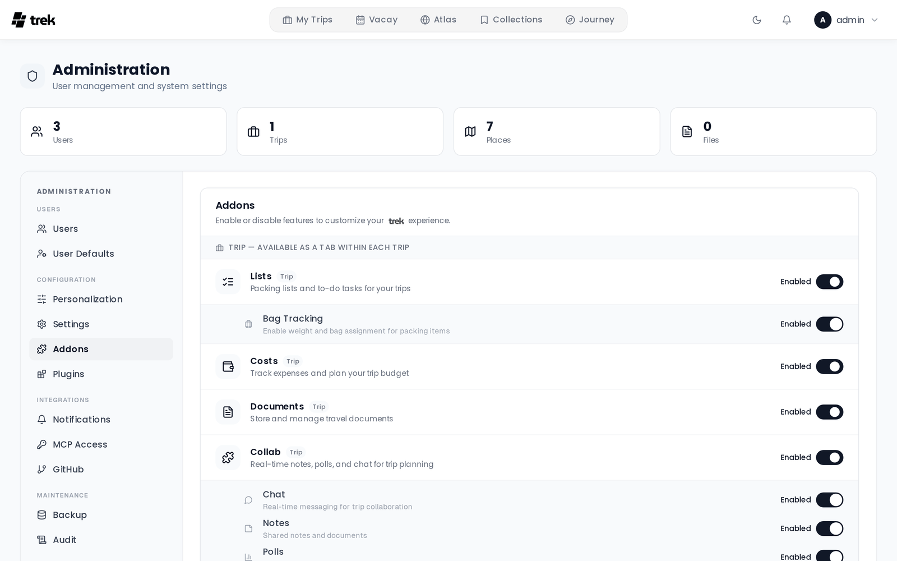

# Admin: Addons

The **Addons** tab (in the **Configuration** group of the admin side navigation) lets you enable or disable optional features for the entire TREK instance. Toggling an addon affects all users immediately: disabling one hides its UI elements and blocks its API routes instance-wide.

## What addons control

Each addon toggle controls a feature set. When you disable an addon, users lose access to that feature everywhere in the app. No data is deleted; re-enabling the addon restores access to existing data.

## Addon categories

Addons are grouped into three columns side by side: **Trip**, **Global** and **Integration**. Each column's head names the type with a short hint and counts how many of its addons are on, and the head of the **Addons** card shows the total as a pill (for example `9/14`; hover it for **{enabled} of {total} enabled**). Each addon is a tile with its icon, name, description and switch; its sub-toggles or settings open underneath the tile while it is on.

### Trip addons

Trip addons add per-trip feature panels. They appear in every trip where the addon is enabled.

The trip addons are: **Lists**, **Costs**, **Documents** and **Collab** (all enabled by default), and **Road trip** and **Tours** (disabled by default). The exact list is determined by what is registered in your TREK database.

**Sub-toggles on trip addons:**

- **Lists**: when enabled, a nested **Bag Tracking** toggle appears. Bag Tracking lets users assign packed items to specific bags.
- **Collab**: when enabled, five sub-toggles appear for individual collaboration features:
  - **Chat**: in-trip real-time chat
  - **Notes**: shared trip notes
  - **Links**: shared trip links, on by default
  - **Polls**: trip polls
  - **What's Next**: the "what's next" widget
- **Documents**: when enabled, one row per document store appears underneath: **Paperless-ngx**, **Papra**, **Nextcloud**, **OpenCloud** and **Synology Drive**. All of them are off by default. Switching a store on only lets trip owners offer it; the address and credentials are entered per trip, in the trip's file manager. Switching a store off pauses the trips bound to it without touching them. Switching **Documents** itself off switches every store off, and each has to be switched on again afterwards; a store cannot be switched on while **Documents** is off. See [Document-Sync](Document-Sync).

Each sub-toggle can be disabled independently while the parent addon remains enabled.

**Road trip** plans a trip as one continuous drive: search along the route, driving limits, daily travel times, via points and avoidance of toll roads, motorways and ferries. **Disabled by default.** It needs no key: routing runs on the public OSRM and Valhalla servers until you set your own under **User Defaults** (**Own routing engine**, **Own Valhalla instance**, restart required). See [Road-Trip](Road-Trip).

**Tours** plans hikes and paddle tours (kayak, canoe, SUP) as tours of their own and adds them to the days of a trip. **Disabled by default.** Underneath its tile, the **wanderer** sub-toggle lets users connect their own wanderer instance and import its trails.

#### Paddle water data

While **Tours** is on, a **Paddle water data** card appears under the addons. It holds the regions TREK knows weirs, dams, locks, rapids, put-ins, take-outs, portage ways and paddling rules for. TREK reads them from OpenStreetMap, from the regional extracts Geofabrik publishes, with a reader of its own; no other service is asked.

1. Search the card for a region, for example *Oberpfalz*. Each hit shows the regions it lies in, so two places of one name tell apart.
2. Click **Add**. TREK downloads the extract in the background, reads the paddle objects out of it and deletes the file. The card shows the download and the reading with their progress, without reloading the page. A large region takes a few minutes; regions are read one after another.
3. Once the region is **Ready**, the card shows how many objects it holds and the date its data is current to.

Paddle tours inside a region show its obstacles on the planner map, each with a card that says how it stands to the route, what paddling rule its tags give and how current the data is. Outside every region a paddle tour says that no obstacle data is known there; TREK never shows the water as free of obstacles.

**Monthly refresh.** Every region with data is read again on the 3rd of every month at 04:20 (server time); **Read again** does it at once. A read that fails keeps the data read before and shows the reason. A restart during a read queues it again. **Remove region** deletes a region and its objects after a confirmation.

**Data and licence.** The objects are OpenStreetMap data, © OpenStreetMap contributors, under the Open Database License (ODbL); TREK shows the attribution next to them. A record in the data is no check on site: weirs, locks and rules change, and the data can have gaps. The download needs outbound access to Geofabrik's server and, while a region is read, room for its extract in the data folder's temporary space (a whole country takes a few gigabytes).

### Global addons

Global addons add features that are not tied to a single trip. The default global addons are **Vacay**, **Atlas**, **Collections**, and **Journey**.

- **Vacay**: personal vacation day planner with calendar view. Enabled by default.
- **Atlas**: world map of visited countries with travel stats. Enabled by default.
- **Collections**: personal place library that saves places across trips into named lists, copies them into any trip, and shares them. **Disabled by default.** See [Collections](Collections).
- **Journey**: trip tracking and travel journal (check-ins, photos, daily stories). **Disabled by default.**

**Sub-items on global addons:**

- The **Journey** addon shows photo provider toggles underneath it. Each photo provider (e.g., Immich, Synology Photos) can be enabled or disabled independently.

### Integration addons

Integration addons connect TREK to external services. Most of them need additional configuration (API keys, URLs) once enabled, but not in the admin **Settings** tab: each one has its own place.

- The **MCP** addon requires `APP_URL` to be set in your environment. When enabled, the **MCP Access** tab appears in the Admin Panel. **Disabled by default.** See [MCP-Overview](MCP-Overview) for full details.
- The **Naver List Import** addon imports the places of a shared Naver Maps list into a trip. **Enabled by default.** It needs no key.
- The **AirTrail** addon syncs flights from a self-hosted AirTrail instance. **Disabled by default.** The toggle here is the instance-wide switch only; each user connects their own instance (URL + API key) in **Settings → Integrations**.
- The **Dawarich** addon reads the stays and recorded routes of a self-hosted Dawarich instance and offers them as suggestions. **Disabled by default.** The toggle here is the instance-wide switch only; each user connects their own instance (address + API key) in **Settings → Integrations**. A Dawarich on your local network also needs `ALLOW_INTERNAL_NETWORK=true`. See [Dawarich](Dawarich).
- The **AI Parsing** addon is the LLM fallback for booking imports KItinerary cannot read. **Disabled by default.** When enabled, its provider, base URL, API key, and model fields appear inline underneath the addon row, with **Model reads images** (**Automatic**, **Yes** or **No**). Automatic asks a local Ollama server whether the model reads images and means no for a cloud provider. When it resolves to yes, the booking import takes photos (JPG, PNG, WEBP) and scanned PDFs are read page by page, and Costs offers **Scan receipt**. Filling the fields in sets the instance-wide config for all users; leaving them blank lets each user configure their own provider in **Settings → Integrations**. See [AI-Booking-Import](AI-Booking-Import) and [Budget-Tracking](Budget-Tracking#scanning-a-receipt).

## Enabling or disabling an addon

Click the switch on any addon tile. The change is applied immediately; no save button is needed. A brief success toast confirms the update.

If a toggle fails (e.g., network error), it rolls back to its previous state.

## Additional configuration

Some addons require credentials or environment variables before they are functional:

- **Documents**: the document stores need nothing instance-wide beyond their switch. The trip owner enters a store's address and credentials in the trip's file manager. A store on your local network also needs `ALLOW_INTERNAL_NETWORK=true`. See [Document-Sync](Document-Sync) and [Internal-Network-Access](Internal-Network-Access).
- **Journey**: works without any external integration. To embed photos from Immich or Synology Photos, enable the corresponding photo-provider toggle listed under Journey, then configure credentials per-user in **Settings → Integrations**. See [Photo-Providers](Photo-Providers).
- **MCP**: requires `APP_URL` to be set so OAuth redirect URIs resolve correctly.
- **Road trip**: works out of the box on the public routing servers. To use your own OSRM or Valhalla, set **Own routing engine** or **Own Valhalla instance** under **Admin → User Defaults**, then restart the server and reload the page. See [Road-Trip](Road-Trip#routing-engines).
- **Tours**: hikes need nothing more. For the obstacles on paddle tours, add the regions you paddle in under **Paddle water data** (see above).

## Related pages

- [Admin-Panel-Overview](Admin-Panel-Overview)
- [Admin-MCP-Tokens](Admin-MCP-Tokens)
- [MCP-Overview](MCP-Overview)
- [Addons-Overview](Addons-Overview)
- [Document-Sync](Document-Sync)
