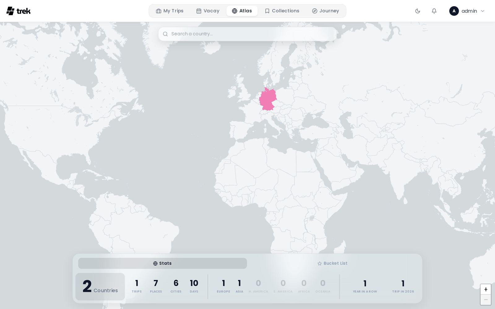

# Atlas

Atlas is an interactive world map that shows countries and regions you have visited across all your trips, together with a bucket list of places you want to go.

> **Admin:** enable Atlas in [Admin-Addons](Admin-Addons).

## What Atlas is

Atlas gives you a visual overview of your travel footprint. Visited countries are highlighted on the map. You can also mark individual sub-national regions and maintain a personal bucket list of future destinations.

## Accessing Atlas

When the admin has enabled the Atlas addon, an **Atlas** entry appears in the main navigation. Your visited countries are populated automatically from your existing trips.

## Visited and planned countries

A country only counts as visited once the trip that takes you there has started. A trip currently under way counts too — you are there. Countries from trips that begin in the future are **planned**, and trips saved without any dates are treated as ideas that stay out of your statistics entirely.

Planned countries are hidden from the map by default. Use the **Show planned countries** switch above the map to bring them in; they appear with a dashed outline so they never look like somewhere you have already been. The switch only appears when you actually have upcoming trips, and it remembers your choice.

Countries you mark by hand always count as visited, whatever the dates of any trip going there.

Countries on your bucket list that you have not been to yet are drawn with a diagonal hatch, in the colour that country would carry once you get there. That keeps a wishlist entry easy to tell apart from a visited country and from the plain grey of everywhere else. Every country keeps its colour permanently: marking one more country as visited never reshuffles the rest of the map.

## Marking countries as visited

Click any country on the map to open an action popup where you can mark it as visited or add it to your bucket list. Use the search bar at the top of the map to find and fly to a country — pressing Enter or selecting a result from the dropdown opens the same action popup.

The search box also finds **places**, not just countries. Type a city, a landmark or an address and the matches appear under a **Places** heading below the country hits. Picking one flies there and works out which sub-national region the coordinate falls in, so you can mark Lombardy as visited by searching for Milan, without knowing that Milan is in Lombardy. Countries with no region data in the map bundle fall back to the country itself.

To remove a manually-marked country (one with no trips or places recorded in it), click it on the map and confirm removal in the popup.

If the country is already on your bucket list, the same popup offers **Remove from wishlist**, which takes every entry for that country off the list without the detour through the Bucket List tab.

Visits detected automatically from your trips are shown in addition to any countries you mark manually.

### Sub-national regions

At zoom level 5 and above, the map switches to a sub-national region view (states, provinces, etc.). You can mark individual regions as visited or add them to your bucket list. Marking a region also counts the parent country as visited if it was not already.

A region on your bucket list is drawn with the same diagonal hatch as a wished-for country, so a state or province you want to see stands out on the region view too.

### A country's places

Clicking a visited country opens its card, with the flag, the number of trips and, once you have been to any, the number of regions. The **Places** badge (*Show the places in this country*) opens every place counted for that country as a list grouped by trip, with a **Search places** box to narrow it. Clicking a place opens the trip it belongs to, so a place imported into the wrong country can be found and fixed.

## Bucket list

The bucket list is separate from "visited". Use it to track countries or places you want to visit in the future. Each bucket list item can have a name, coordinates, country code, optional notes, and a target date. An entry can also be a region rather than a whole country.

## Dawarich

With the [Dawarich](Dawarich) addon on and your own instance connected, the Atlas can read your recordings. On the desktop, a Dawarich panel sits at the bottom of the map, left of the statistics, with two buttons: **Wishlist** and **Countries**. On a phone, a **Dawarich** button sits next to **Bucket List**. Both open the same dialog.

- **Wishlist** checks your bucket list against the stays Dawarich recorded. A wish counts as reached within 250 m and after 20 minutes on the spot, and one wish belongs to exactly one stay. **Tick off _n_** marks the selected wishes visited on the day of the stay. On the desktop bucket list such a wish shows that date with the tooltip *Ticked off from your Dawarich recordings*; click the date to undo it.
- **Countries** lists the countries and cities your recordings cover that are not yet marked visited, with a flag and a city count. **Add _n_ countries** marks them visited, recorded as coming from Dawarich. A country you marked by hand keeps saying it was marked by hand.

Nothing reaches your Atlas until you confirm it. See [Dawarich](Dawarich) for the connection and the full rules.

## Statistics

Your Atlas statistics panel shows:

- **Countries visited** — total number of distinct countries you have actually been to. Countries from upcoming trips are counted separately and shown next to this number.
- **Regions**: the number of sub-national regions (states, provinces) you have visited.
- **Trips** — total number of trips across all time.
- **Places** — total number of individual places logged in trips.
- **Cities** — total number of distinct cities visited, derived from the addresses of your places. TREK drops the last comma-separated part (the country), then walks back through the remaining parts and takes the first one that is still non-empty once digits, hyphens and postal marks are stripped, lower-cased so spelling variants collapse into a single entry. This is a heuristic over a formatted address string rather than a lookup, so the figure is approximate: a short address such as `Osteria Francescana, Italy` leaves nothing but the place's own name, and an address whose administrative tail ends on a state or prefecture (`…, Shibuya, Tokyo, 150-0002, Japan`) counts that region rather than the city.
- **Travel days** — total days spent travelling.
- **Continent breakdown** — number of countries visited per continent (Europe, Asia, North America, South America, Africa, Oceania). Antarctica joins the row once you have been.
- **Travel streak** — number of consecutive years in which you have taken at least one trip.
- **Trips this year** — number of trips in the current calendar year.

## Tour activities

With the Tours addon on, the desktop panel has a third tab, **Tours**, next to **Stats** and **Bucket List**: what you have done on your tours across all your trips. Pick a **period** (all time, this year, the last 12 months or an earlier year) and a **tour type**, and the tab shows the distance with the number of tours at its corner, the ascent and descent, and the types with their distance. **Show tours** opens every tour of the period as a list.

- **When a tour counts.** A tour counts once the day it is on in a trip is over; a tour on several days once the last of them is over. A tour on no day, a tour only on days without a date and a tour whose day is still ahead do not count; the tab says how many of each there are.
- **Planned or recorded.** Until you link the track you actually took in the tour's detail, a tour counts with the values of your planning, and it says so with a **Planned** badge: they are not measured. A linked actual track replaces those values for that tour, marked **Recorded**; it is never added on top, and the track itself is not counted as a tour of its own.
- **Only your own part.** A day of a tour counts for you when it names you among its participants, or names nobody, which in the planner means everyone of the trip. A day that names only others counts for them, not for you.
- **No double counting.** A tour planned on several days counts once. A whole route that the stages of a multi-day tour were planned from does not count beside them while one of those stages counts; a stage still ahead or left out does not hide it. A paddle tour adds no ascent or descent, and a value a tour does not know stays out of the sum, which then reads "at least".
- **Leave a tour out.** A tour that fell through can be left out in the list with **Leave out**. It stays in the plan, its route and days do not change, it stays in the list dimmed, and **Count again** brings it back. Leaving it out changes only your own numbers.

The tab reads live and needs a connection.

## Visual effect

The desktop glass panel at the bottom of the map uses a liquid-glass visual effect — a dynamic inner glow and border highlight that follows your cursor across the panel.

## Plugin country layers

Installed plugins can tint countries on the Atlas map with their own layers — for example wishlists or travel advisories. A plugin implements the `atlasLayerProvider` hook and returns one or more layers, each a set of ISO country codes with a tone; TREK validates the codes and tints them itself. Layers are per-user and additive: a plugin never touches the map canvas, and one that errors or is slow contributes nothing.

> **Plugins:** requires the `hook:atlas-layer-provider` permission. See [Plugin-Development](Plugin-Development) for the hook contract.

## See also

- [Addons-Overview](Addons-Overview)
- [Admin-Addons](Admin-Addons)
- [Dawarich](Dawarich)
