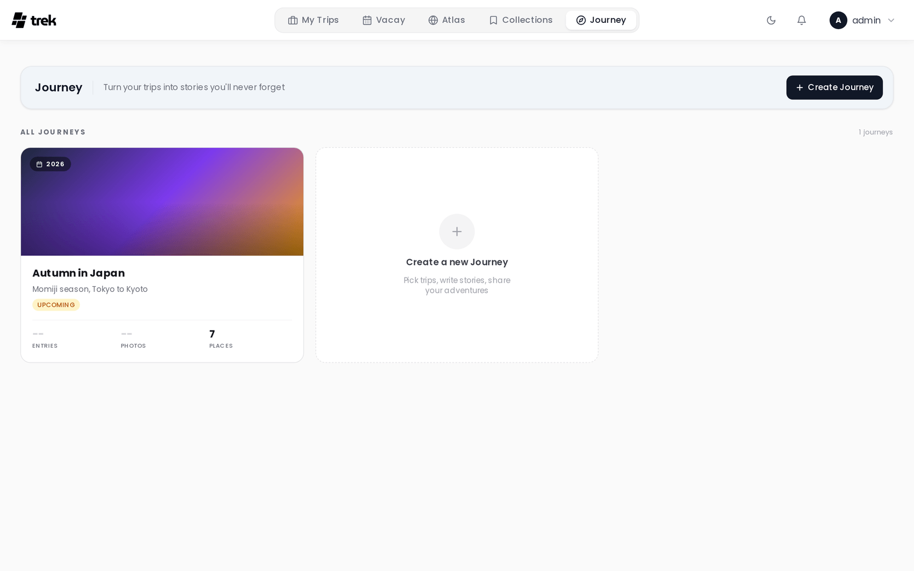
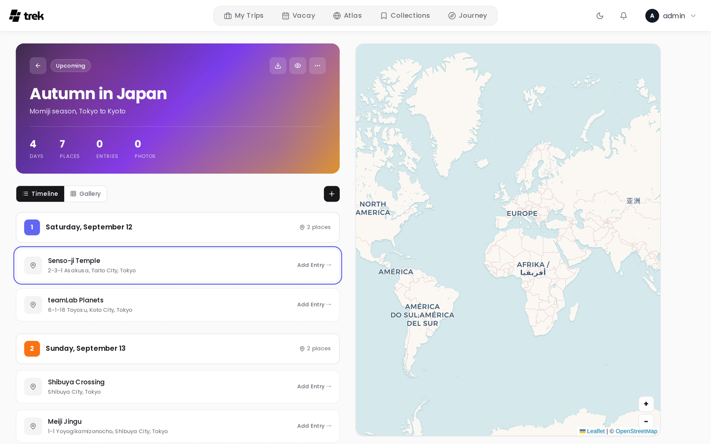
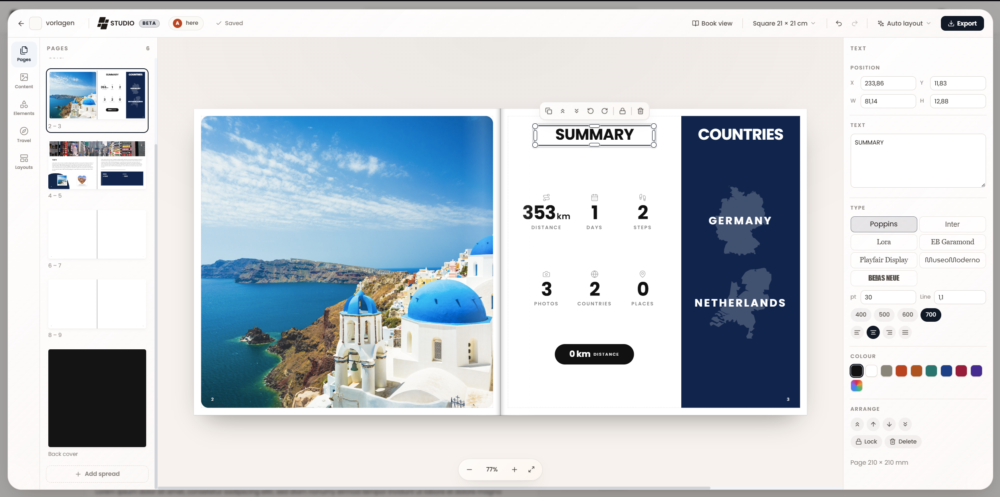
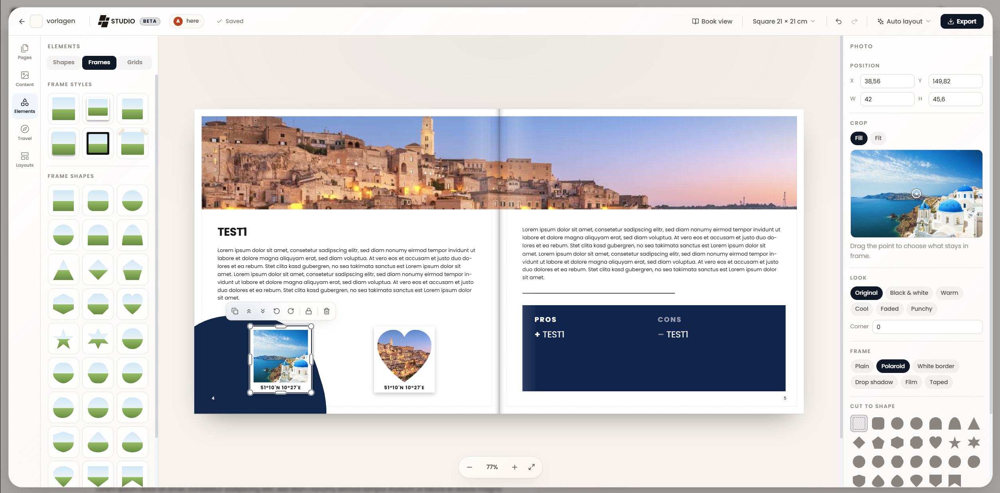

# Journey Journal

Journey is a photo-first travel journal. Each journey is linked to one or more of your trips and contains per-day entries with text, photos, mood, and weather.

> **Admin:** enable Journey in [Admin-Addons](Admin-Addons).

## What Journey is

Journey lets you write a narrative account of your travels alongside your trip plan. Entries are tied to specific days and can include prose, photos, a mood rating, weather conditions, and verdict cards. Completed journeys can be shared publicly with a read-only link.

## Accessing Journey

When the admin has enabled the Journey addon, a **Journey** entry appears in the main navigation. The Journey list page shows all your journals as cards with cover images, entry counts, photo counts, and place counts.

## Creating a journey

From the Journey list, click **Create journey**. Give it a title and optional subtitle, then select one or more existing trips to link. Linking a trip imports the trip's places as location anchors for your entries — one anchor per day the place stands on, so a place you kept across two days gives you an entry on each of them. You can link additional trips later from the journal settings.

A place brought in from a linked trip sits in the timeline as a **suggestion** until you write into it. One you will not use can be dismissed on its own, with **Dismiss this suggestion** on its card (on a phone, in its sheet). A dismissed suggestion leaves the journey without being deleted, and the trip sync does not offer the same place again. **Journey Settings** shows how many you dismissed and **Bring back dismissed suggestions** returns them all.

## Journal entries

Each entry corresponds to a day in your journey. The entry editor provides:

- **Title** — a short heading for the day.
- **Story** — free-form text that supports Markdown formatting.
- **Mood** — choose one of four values:

  | ID | Label | Color |
  |---|---|---|
  | `amazing` | Amazing | Pink |
  | `good` | Good | Amber |
  | `neutral` | Neutral | Grey |
  | `rough` | Rough | Violet |

- **Weather** — choose one of six values: Sunny, Partly cloudy, Cloudy, Rainy, Stormy, Snowy. (Snowy is stored under the id `cold`.)
- **Photos and videos** — attach photos to the entry. The first photo becomes the card thumbnail in list views. A video clip goes on an entry the same way: `mp4`, `m4v`, `webm` or `mov`, up to 500 MB per file. The clip is stored as uploaded, without transcoding, and the editor shows its first frame as a preview before you save. The journey gallery takes the same clips.
  > **Note on HEIC files:** HEIC is an Apple-only format that many browsers and platforms do not recognise as an image. To ensure broad compatibility, HEIC/HEIF files are automatically converted to JPEG before upload. This conversion may result in the loss of embedded metadata (EXIF data such as GPS coordinates, camera information, etc.).
- **Pros / Cons** — optional verdict cards. Add items to a **Pros** list (thumbs-up) or a **Cons** list (thumbs-down) to summarise what you loved or what could have been better. These are stored in the `pros_cons.pros` and `pros_cons.cons` arrays on the entry.
- **Tags** — free-form labels (e.g. "hidden gem", "best meal").
- **Location** — pin the entry to a map location.
- **Time** — optionally record a time of day for the entry.
- **Draft**: a switch at the bottom of the editor. A draft entry is seen only by you and the other contributors, carries a **Draft** mark, and the shared journey leaves it out until you switch it off.

### Photo order

In the entry editor the photos can be dragged into any order. The first one is marked **1st** and is the entry's cover; hover another photo and click **Make 1st** to move it to the front. The order is the same for every member, on the share page and in Studio.

### Linking the trip a date falls in

When the date of an entry falls inside one of your trips that the journey is not linked to yet, the editor names that trip: *This day falls in this trip. Link it, and its places join this journey.* **Link Trip** links it in one click, **Not now** leaves it. When several trips cover the date, the shortest one is suggested.

### Entry fields

Mood, Weather and Pros / Cons can be switched off for a journey that does not use them. Open **Journey Settings** and use the switches under **Entry fields**: **Mood**, **Weather** and **Pros & cons**. Nothing already written is lost: the form stops asking, the stored values stay, and switching a field back on brings them into view. A shared journey hides the fields its owner switched off as well.

### Getting around a long journal

Everything that adds to a journal sits at the top of the page — the **Add Entry** button, the gallery upload — while what you were last reading sits at the bottom. On desktop, two small round buttons float centred over the timeline, just above its bottom edge, once there is more than 400 px of scroll to travel: one jumps back to the top, the other to the last entry. Each appears only when there is somewhere to go in that direction.

A journey that is still under way opens on today rather than at its first entry, as long as today falls inside it; a day with nothing written lands you on the last entry before it. A journey that has ended opens at the beginning.

On desktop, the **Search this journey** box in the toolbar filters the timeline as you type, across the titles, stories, places and tags of the entries. Matching ignores case and accents, so `cafe` finds `Café`.

Next to those two buttons, a **Jump to a day** pill (labelled with the number of days) opens every day of the journey; open a day to see its entries, and picking a day or an entry scrolls straight to it.

Each day header carries a **+** button, **Add an entry on this day**, which opens the editor with that date already set, so an entry for an earlier day no longer starts on today.

### External photos

The entry editor includes an **External photos** tab for connected Immich and Synology Photos libraries. It searches the selected calendar day automatically. When the entry has a pinned location, photos with GPS metadata are shown nearest to that location first. Photos without GPS, and photos taken farther away on the same day, remain available below the nearby results; no distance cutoff is applied.

External selections are queued with the other editor changes and saved only when you click **Save**. If a provider is unavailable or its metadata has no GPS coordinates, Journey falls back to the normal date-based photo list.

The same photo picker opens from the journey gallery, on desktop and on a phone. **Select all** takes every photo of the search, not only the ones scrolled into view: on the day, **Trip Period** and **Date Range** tabs it first loads the pages still missing, with a spinner on the button while it does, and closing the picker or switching tab cancels it. **All Photos** is your whole library, so there Select all takes only the photos loaded so far, and a count such as **(200+)** says there are more further down. Select all adds to what you already picked on another tab or in an album, and **Deselect all** takes back only the photos in view. **Add** waits until Select all has finished loading, so it never sends only part of the selection. The picker loads up to 50,200 photos of one date search, by Select all or by scrolling, far more than a trip usually holds; past that the count keeps its **+**, and a narrower **Date Range** reaches the rest. A large selection is sent in several requests, and if one of them fails, the photos that did arrive show up in the journey straight away while an error says the rest did not; adding the same selection again skips the photos that are already there.

Imported photos are added oldest first, so an entry lists a bulk import in the order the photos were taken, and you can still drag them into another order afterwards. The gallery sorts by capture time, which TREK asks Immich or Synology Photos for right after the import; once those times arrive the gallery re-sorts by itself on every device that has the journey open.

### Viewing photos

Clicking a photo opens it full size. The viewer zooms with the mouse wheel, a double click, the **Zoom in** and **Zoom out** buttons or a pinch, and a zoomed photo can be dragged around. **Back to full photo** resets the zoom.

## Journey status

By default a journey's status follows the dates of its linked trips; without a linked trip it stays a draft. To set it yourself, open **Journey Settings** and pick **Status**: **Automatic**, **Draft**, **Live** or **Completed**. A status set by hand stays until you switch back to **Automatic**.

**Archive Journey** in the same dialog hides the Live badge; **Restore Journey** reopens it.

## Mobile timeline

On a phone, entries sit in a horizontal carousel over the map, one photo card per entry. The entry's first photo is the card (a pin placeholder when it has none), with the title and place on it, the country flag and the date in the corners, and the mood and weather icons next to the date. A suggestion from a linked trip shows a plus mark and its title in italics. The day an entry belongs to is carried by the colour of the card's edge, the same colour its map marker uses; there is no day number on the card. Tap the centred card to open the entry in a sheet.

Above the cards, once the journey spans more than one day, a day bar shows one segment per day in the day's colour: it tells you how long the journey is and how far in you are, and tapping a segment, or pressing the date above it and sliding sideways, jumps to that day.

The **+** in the bottom bar starts a quick capture for a moment on the move: a title, a picture (**Photo** takes one with the camera, **Gallery** picks from your phone) and a short note. Your current position is filled in as the entry's location, the place name is looked up from it, and the current weather is set when it can be. **+ Details** opens the full form. From the header of an entry's sheet, the two arrows move the entry earlier or later within its day; suggestions do not take part.

## Map view

The journey detail page includes a map on the right (desktop) or an integrated map-timeline (mobile) showing all entry locations alongside the places from linked trips.

**GPX tracks are drawn too.** Any route you imported into one of the journey's linked trips, from a `.gpx`, `.kml` or `.kmz` file, appears on the journey map as well, in the same colour it has in the trip planner and with a white casing so it stays readable on satellite tiles. They come with the trips linked to the journey, also a trip nobody has written about yet, while **Show trip tracks** is on in the journey settings. Hovering a track shows its name. A trip's track is the plan, so it is drawn dashed; what was recorded, a day the journey keeps or the live [Dawarich](Dawarich) route, is drawn solid.

### Map layers

The journey map shows four layers, each switched on and off at the top of the map; the switch is yours and remembered in this browser, per journey, and it changes nothing in the trip, the entries or the photos.

- **Plan**: the places the linked trips put on their days, as hollow dashed pins in their category colour, and the trips' GPX routes. A place you wrote an entry about is not drawn twice: the entry's pin carries a small check instead. A planned place is no proof of a visit.
- **Recorded**: the days of route the journey keeps and the live [Dawarich](Dawarich) route.
- **Entries**: the journal entries with a place, and the stays a day report was taken over from, each as a small dot where it was recorded, so a report that covers several places shows them all without an entry per place.
- **Photos**: the photos that know where they were taken.

Each switch shows how many things it holds; a layer with nothing to show is dimmed and says why, one that could not be loaded is marked and the rest of the map keeps working. Marks on one spot join into a disc with their number, and a click lists them. A click on a planned place or a stay opens a card with its trip, days and times and, where there is one, a button to the entry. The **i** button beside the switches explains every pin, dot and line. The layers work the same on a phone and on a shared journey.

The thin dashed line connecting entries in date order is something else and stays as it is: that one is drawn by TREK, while a track is a route.

### Keeping a recorded day

With a [Dawarich](Dawarich) connection, a journey can keep the route you actually travelled on one of its days, so it stays on the map after the connection is gone or the instance is down.

1. In the timeline, the header of each day carries the Dawarich mark. Click it (on a phone: **More options**, then **Recording of** the day of the card you are on).
2. The dialog names the journey and the day and reads that day from your Dawarich. Nothing is kept yet.
3. **Time zone of the day** decides where the day starts and ends. TREK starts with the zone Dawarich records in when its answer shows one, else the zone of your device; pick the one you were travelling in.
4. Check what the day covers: a sketch of the route, the distance, the first and last time, the pieces and the gaps in the recording, the modes Dawarich gave them, and whether it came as tracks or as thinned points.
5. **Keep route** keeps it. The day header then shows the distance, and the route appears on the journey map in the colour of that day's pins.

What you should know:

- **Gaps stay gaps.** Where the recording stops, the line stops too; TREK never draws a way between two pieces that was not recorded.
- **Taking the same day over again keeps no second copy.** When Dawarich now holds a different version (a day that was still running, a recording that was fixed), the dialog says so and **Replace** swaps it. Replacing never touches entries or texts.
- **What you keep is what you saw.** If the recording changes in Dawarich while the dialog is open, nothing is kept and the dialog shows the new version first.
- **A failed read changes nothing.** The version the journey keeps stays as it is, and the dialog offers **Try again**.
- **Everyone on the journey sees the route**, also when an editor kept their own recording; the dialog says how many people that is. Shared links show recorded days only when the owner switches on **Recorded routes**.
- **Remove route** in the dialog takes the day off the journey again, also without a Dawarich connection. Dawarich keeps its own recording either way.

### Taking over a day with its stays

The stays [Dawarich](Dawarich) detected on a day (the café, the square, the museum) can become journal entries in one go, instead of one by one.

1. In the timeline, the header of each day carries a list button beside the route; it shows how many stays of the day are still waiting. The row with the day's stays has a **Take over day** button too. On a phone: **More options**, then **Take over** the day of the card you are on.
2. The dialog reads the day from your Dawarich again and shows its route and its stays on one map, numbered in the order you lived them, and lists them with their times and how long you stayed. A stay Dawarich only guessed, or is unsure about, says so; one without a position says it will not be on the map.
3. Choose the stays you want and correct their names. Two stays of the same place in a row (you left the square for a coffee and came back) start joined as one entry; **Keep apart** separates them, **Join into one entry** joins any two neighbours. A joined entry gets a title and the stay it sits at on the map.
4. **Day report** turns all chosen stays into one entry that lists them with their times, with a title and one map position (or none). Every stay stays on record with its own place, so a report does not cost you the places it covers.
5. **Keep the day's route too** keeps the route as well, when the journey does not keep it yet.
6. **Take over** writes the entries as drafts. Add photos and text afterwards, then publish them as usual.

What you should know:

- **Nothing is written before the button.** Cancelling leaves the journal and your stays as they were.
- **Nothing is written twice.** Stays the journal holds already are marked with the entry they are in and cannot be chosen again; taking the same day over again, or retrying after an error, writes no second entry.
- **What the journal holds stays as it is.** Existing entries, texts, photos and places are never changed; the dialog lists the day's entries so you see what is there.
- **Stays you leave out** are no longer pending on that day; you can restore them in the Dawarich stay list.
- **Drafts never appear on shared links.** Everyone on the journey sees them; the dialog says how many people that is.
- **When Dawarich does not answer**, the dialog says why and shows the stays of the last sync instead, so you can still take them over.

### Preparing recorded days automatically

While you travel, the stays of each day can be ready for review without you starting anything. In **Journey Settings**, under **GPX Tracks**, the owner switches on **Prepare recorded days automatically**. It is off by default.

- The background check of [Dawarich](Dawarich) then also reads the days of the trips linked to the journal, for the owner and for every editor with a Dawarich connection of their own. Everyone gets only their own stays; nobody else's recording is read.
- In the timeline, a day with stays waiting shows their number on its list button, and a click opens the review of that day. A small dot marks a day that is not final yet: it is still running, its stays were fetched before it ended, nothing was fetched yet, or the last refresh failed and the day shows an older state. The tooltip says which.
- Under the switch you see when your stays were last fetched, or why it did not work (no connection, no linked trip with dates, background check switched off, or the reason of the last failure, with the state still shown). **Fetch now** asks Dawarich at once; switching the preparation on does that by itself.
- Stays recorded later and stays Dawarich changed come in with the next check. Stays you took over or left out are not offered again, and nothing in the journal is ever written or changed on its own: taking a day over stays your decision.
- Switching it off stops the preparation. Everything you took over stays as it is.

**Geotagged photos are drawn too.** A photo of the journey that knows where it was taken appears on the map as a thumbnail, and photos taken close together collapse into one thumbnail with a count. Click one to open those photos in the viewer.

**Place entries from their photos**, a switch under **Photos** in **Journey Settings**, goes one step further: an entry without a place takes the spot where its first photo with GPS was taken. Places you set yourself are never moved. It is off by default.

## TREK Studio

A journey can also be laid out as a printable photo book. Open a journey and click **Studio** in the header. The designer opens on top of the journey at `/journey/:id/studio`, so the journey stays open underneath and **Back to the journey** drops you straight back into it. Studio is marked **Beta**.

- **Page format** — Square 21 × 21 cm (the default), Square 30 × 30 cm, A4 landscape, A4 portrait, A5 landscape, or a custom width × height in millimetres. Everything is drawn as a spread (two pages side by side) with 3 mm bleed and a 5 mm safe margin.
- **The shape of the book** follows a bound one: a cover, a single first page on the right (page 1, where a title page or a dedication goes), the spreads, a single last page on the left, and a back cover. The first and last pages take the cover layouts and, like the covers, stay where they are; new spreads always go between them. Page numbers, when switched on, count from the first page, and the number on screen is the number that prints. Books made before this had no single pages and keep their numbering as it was.
- **Auto layout** has two entries. **This spread** builds the spread on screen again from the journal entry it came from, and is only offered on a spread that came from one. **The whole book** replaces every page, keeping your title and page setup. Both are ordinary undo steps, so you can press one, look at it, and undo.
- **Pages, Content, Layouts, Elements and Travel** are the sections of the left rail, in the order a book is made, with **Theme** and **Layers** set apart below them. The rail and the tabs inside its panels answer to the arrow keys. Content holds the journey's own photos and entries, with **Upload photos** and, when Immich or Synology Photos is connected, **From Immich** or **From Synology Photos** to add photos from your library the way the journey gallery does; Layouts opens on **Designed pages**, whole pages laid out by a designer: 21 covers in seven styles (spine band, poster, cut-out, postcard, grid and badge, minimal, stamps) for the cover and the other single pages, and 16 double spreads for the pages between. Each card shows the page you are on as the click will lay it, with its own photos and words in the template and in the book's theme, and the style chips narrow the set to one look. Below them come the book's own layouts and the built-in ones: thirteen spread layouts (Hero and story, Four up, Strip and text, Mosaic and so on) plus a separate set of five for the cover and back; Elements has six tabs: text styles, shapes, lines, empty frames with their frame styles and grids, a searchable icon library, and the stickers; Travel builds figures out of the journey itself: route maps, country outlines and lists, flags, date, day and distance marks, and a trip summary. Theme sets the look of the whole book, and Layers lists the page front to back.
- **Properties** on the right edits whatever is selected, in the same order for every kind: what the element is or says (a text's words, a photo's crop and focal point, a shape), then its position and size, then its look (type, colour, fill, frame, corner), then its effects, and last **Arrange** (aligning, stacking, grouping, copying a style, and a button that shows the page in Layers). The groups you set rarely start folded and open by themselves on an element that already uses them. With nothing selected it shows the page background, the book's theme and the page numbers. An element that auto layout tied to a journal entry follows that entry until you edit it here, which breaks the link.
- **Copy and paste**: a selected element copies with Ctrl+C and pastes on any page with Ctrl+V or the paste button.
- **My layouts**: **Save this page as a layout** keeps the arrangement of a page without its photos, for every editor of the book, and applying it lays another page out the same way while keeping that page's photos and words. A book keeps up to 24 layouts.
- **Export** opens a print view that your browser turns into a PDF. Pick **Single pages** (one leaf per sheet, what a printer wants) or **Spreads** (two pages at a time, the way the book opens), with optional crop marks that add the bleed on every edge and mark where to cut.
- **Spreads travel between books.** Download the spread you are on as a design file and import it into another book. The file carries the design only, not the photographs.
- **Several people can design at once.** Everyone in the same book sees the others' pointers with their names on them, and a save is pushed to the rest live. A save that lands on a version somebody else has already changed comes back as a conflict, with the other version alongside it, rather than quietly overwriting their work.

The book belongs to its journey and inherits its access exactly: anyone who may read the journey may open its book, and only those who may edit the journey may save or delete it. There is no second set of permissions to keep in step.

Studio is desktop only: it needs a viewport at least 1024 px wide. Below that — a tablet, or a narrowed browser window — it opens over the journey and shows a "Studio needs a bigger screen" notice with a way back. On a phone the journey opens in its mobile view as usual and Studio is not offered at all. Making the PDF is desktop only too.

## Plugin entry rows

Installed plugins can add extra rows to a journal entry card via the `journalEntryProvider` hook. A plugin returns rows (`label`, optional `value`, optional `url`) and TREK renders them natively under the entry — no iframe. Rows are additive and fail-safe: they require the Journey addon, the entry's journey is access-checked the same way as reading it, only http/https/mailto links are allowed, and a provider that errors or is slow is simply skipped.

> **Plugins:** requires the `hook:journal-entry-provider` permission. See [Plugin-Development](Plugin-Development) for the hook contract.

## Public sharing

You can share a journey with a read-only public link. When creating the link you can independently toggle which sections are visible to visitors: **Timeline** (entries and stories), **Gallery** (photos), and **Map**. Visitors can only see the sections you have enabled, and no TREK account is required. Entries marked as **Draft** are left out of the shared journey until you publish them. See [Public-Share-Links](Public-Share-Links) for details on the separate journey share token mechanism.

**Photos appear on the public map too**, as long as **Gallery** and **Map** are both on. A gallery photo that knows where it was taken becomes a thumbnail pin, clustered into one pin where several were taken close together, and sitting below the entry pins so the itinerary stays the point of the map. The location comes from the file's own EXIF for uploads and from Immich or Synology for provider photos, and a photo that carries none simply stays off the map (see the HEIC note above — that conversion drops GPS, so iPhone uploads usually arrive without a location).

Both toggles matter. A photo's coordinates follow the **Map** switch: with Map off the gallery is still shared, but every photo's coordinates are stripped before they leave the server. With Gallery off no photos are sent at all, so a map-only share shows the entry pins and nothing else.

**Trip plan** and **Recorded routes** add two more layers to the shared map, both off until you switch them on and both only while **Map** is on. Trip plan shares the planned places and GPX routes of the linked trips; Recorded routes shares the recorded days that have a published entry, which shows where you were, your accommodation too. Stays of published day reports show with the map; drafts and everything on them stay off the shared page.

## See also

- [Addons-Overview](Addons-Overview)
- [Admin-Addons](Admin-Addons)
- [Public-Share-Links](Public-Share-Links)
